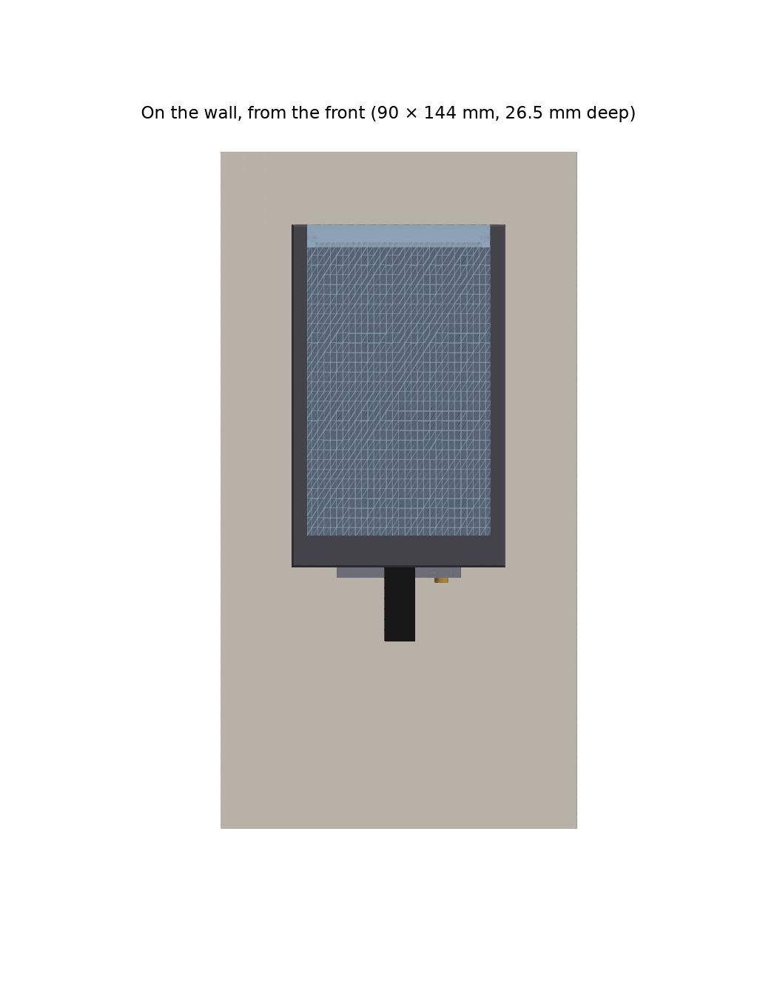
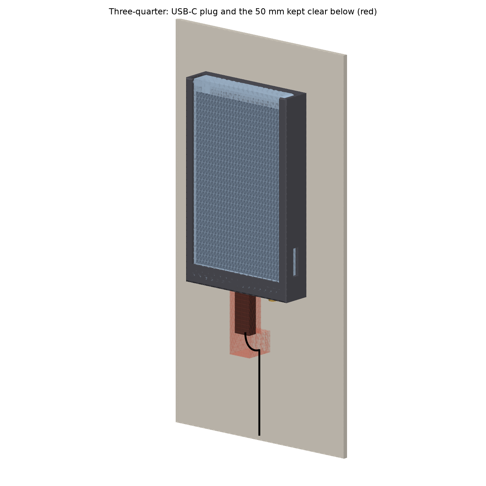
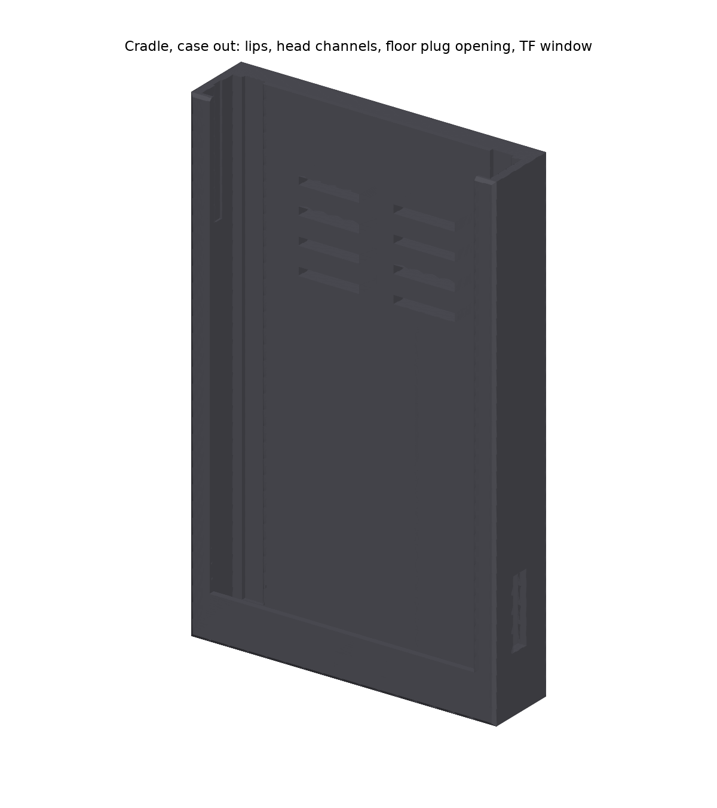
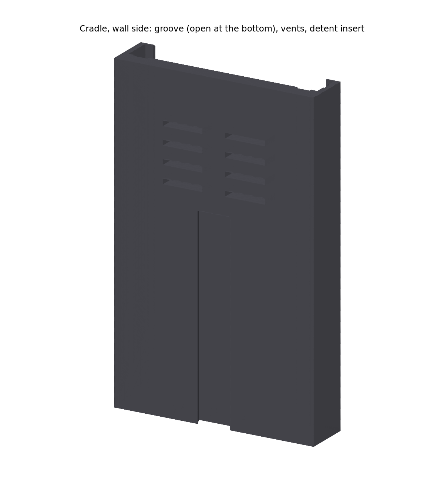
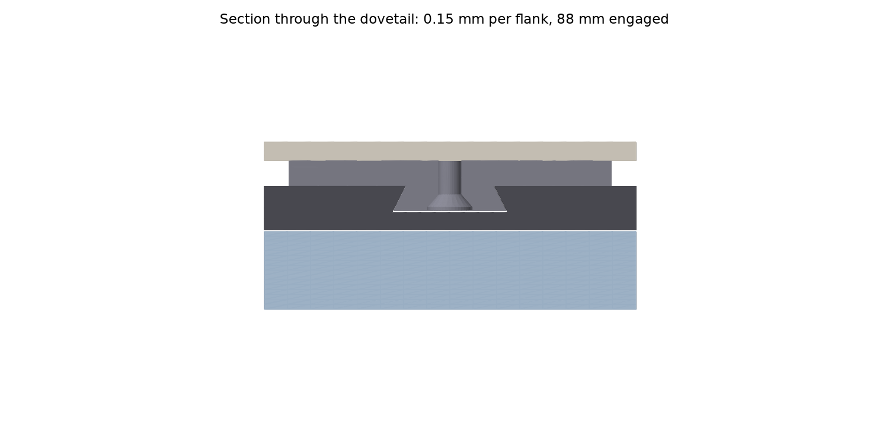
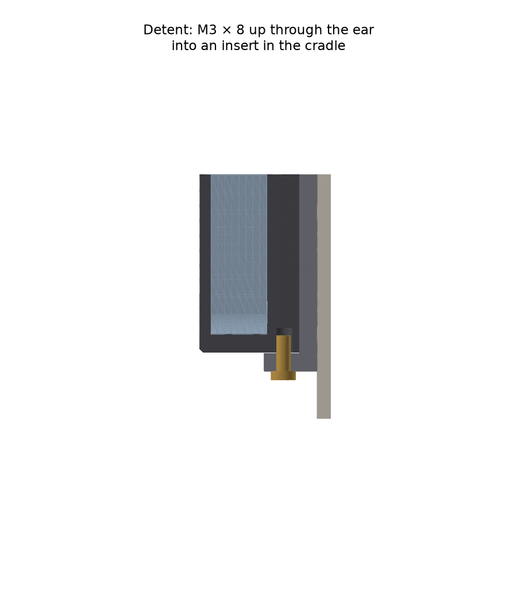
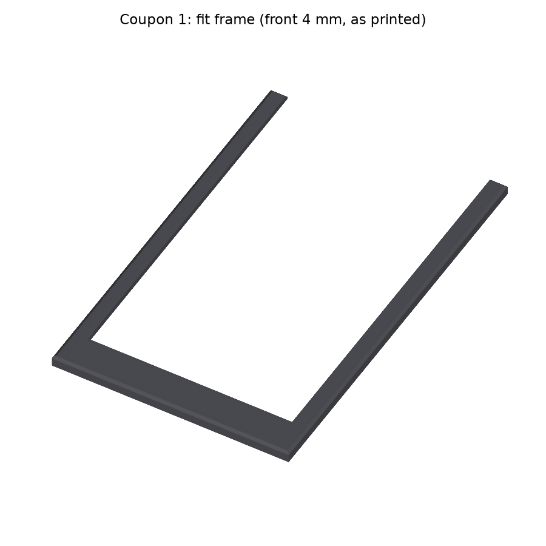
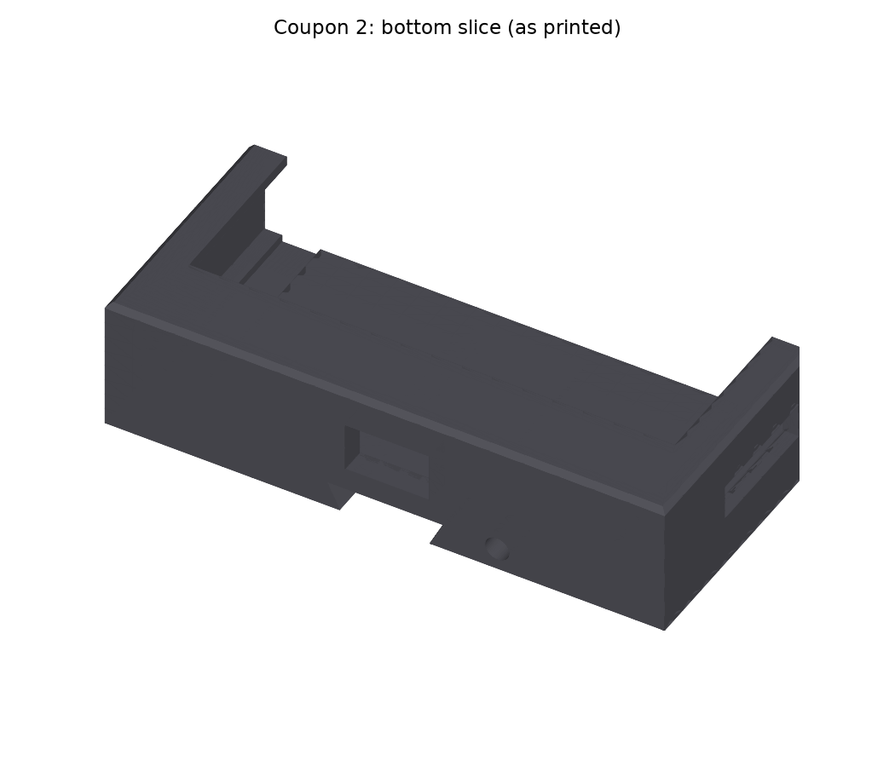
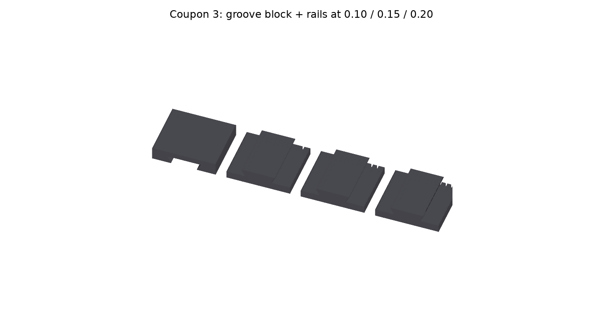

# Basement lights dashboard: wall mount

A 3D-printable wall mount for [`apps/basement-lights-dashboard`](../../README.md): the Elecrow CrowPanel 5.0" HMI (Basic) stays in its stock acrylic case and drops into a black PLA cradle. The cradle slides down a dovetail rail on a plate screwed to the wall. It's a parametric Python model built with [build123d](https://github.com/gumyr/build123d), on the same pattern as the [espframe stand](../../../espframe/hardware/stand/README.md) and the [media room remote enclosure](../../../media-room-dashboard/hardware/enclosure/README.md). One command rebuilds every print file, the preview images and a set of fit checks. Linear COM-534.

| | |
|---|---|
|  |  |
|  |  |
|  |  |

## How it works

Left and right are as seen from the front. The panel hangs portrait with its USB-C at the bottom, which is what the firmware's default `screen_rotation: "90"` already draws upright.

- **Size.** The cradle is 89.5 × 144.2 mm, and its face stands 25.65 mm off the wall. The plate behind it is 52 × 92 mm.
- **Cradle (black PLA).** The case slides in from the open top and stands on a 4 mm floor. There's no top retention: gravity, the floor and the side lips hold it.
  - **Lips.** 1.5 mm lips cover the acrylic border down both sides and across the bottom. Each stops 0.5 mm outside the case's 121.1 × 76.7 window, so the whole screen and its 108 × 64.8 active area stay clear. The top border is left open.
  - **Back.** A flat 7 mm back. The case's four M2.5 screw heads stand 1.14 mm proud of its back plate, so they ride down two channels in the back's inner face as the case slides in. A 0.6 mm relief in the left wall does the same for the LCD flex tab, which pokes 0.35 mm out of the case's side. Vent slots in the back sit above the plate, so they open onto the 4 mm gap behind the cradle rather than onto the plate.
  - **USB-C.** The plug goes up through a 13.5 × 8 opening in the floor, on the receptacle's axis 15.9 mm off the wall. 50 mm below the case is kept clear for the plug and its bend.
  - **TF card.** A window in the right wall exposes the case's TF slot, 14.6–31.1 mm up from the case's bottom edge, so the card can be swapped with the panel on the wall.
  - **Antenna.** The ESP32-S3 module's antenna is at the top end. The cradle stops level with the case's top edge, and no screw or insert is within 55 mm of the antenna.
- **Wall plate (black PLA).** A 4 mm plate with a dovetail rail (14 mm at the root, 18 mm at the tip, 4 mm high) running its full 88 mm, from level with the cradle's underside to the plate's top end.
  - **Wall screws.** Two #6 countersunk wood screws, 60 mm apart on the centre line, go through the rail. Their heads sit 0.5 mm below the rail face, so the groove slides over them. The plate is its own drilling template: hold it level against the wall (its top edge is square) and mark through both holes.
  - **Dovetail.** The cradle's groove is open at the bottom and closed at the top. That closed top end sits on the rail's top end, so the weight goes straight down the rail and no cantilever carries it, which matters for PLA creep. The flanks have 0.15 mm clearance each, measured square to the flank.
  - **Detent.** An ear at the plate's bottom reaches under the cradle, 0.3 mm below it, so it never carries the weight. An M3 × 8 screw goes up through it into an M3 insert in the cradle's underside, so the cradle can't be knocked off the rail. The screw is reached from below, right of the plug.
- **BOOT and RESET aren't reachable.** The stock case's back plate has no holes over them; its only holes are the four screws and four Ø4 holes at the corners. Flashing over USB doesn't need them: the board's CH340 USB-UART bridge drives the ESP32-S3's auto-reset, the same as with the case on the desk.

## Updates, flashing and removal

Normal firmware updates go over Wi-Fi (see the [dashboard README](../../README.md)). For USB flashing or recovery, the panel stays on the wall: its power cable is already in its USB-C port, so unplug the cable's far end from its charger and plug it into the PC. The CH340's auto-reset needs nothing else.

To take the panel off the wall (to service the case or the panel):

1. Undo the detent screw from below (M3 socket head, 2.5 mm hex).
2. Lift the cradle straight up 88 mm, until the bottom of its groove clears the top of the rail, then pull it away from the wall. The groove is open at the cradle's underside, so the whole 88 mm lift is needed. **Leave at least 95 mm of free wall above the cradle** (no shelf or ceiling closer).
3. Unplug the USB-C from below. The case lifts out of the cradle's open top.

## Download the print files

Every merge to `master` that changes the mount attaches `basement-lights-wall-mount-<version>.tar.gz` to that build's [GitHub release](https://github.com/rcompton78/compton-diy/releases). The tarball holds the 3MF/STL/STEP files, `checks.txt`, this README and the preview renders. CI only publishes it when every check passes.

## Building

```bash
pnpm nx run basement-lights-wall-mount:cad
```

This creates (or refreshes) a local Python venv (`setup.sh`, Python 3.10–3.13, pinned `requirements.txt`, the same pins as the other print projects). It then runs `python -m mount.build`, which:

- builds the cradle, the plate and three test coupons, and writes `out/basement-lights-wall-mount-*.{stl,3mf,step}` in their print poses. `out/` is gitignored.
- runs the checks below, writes `out/checks.txt`, and exits non-zero if any check fails.
- renders the preview PNGs into `docs/`. These are committed so this README shows them.

`pnpm nx run basement-lights-wall-mount:release` runs `cad`, then packs the tarball into `dist/basement-lights-wall-mount/` with `scripts/pack-hardware-release.sh`. On merge to `master`, `.github/workflows/release.yml` runs it on the self-hosted runner, with the venv cached at `/hdd/compton-diy/venv-basement-lights-wall-mount`.

Every dimension is a named constant in [`mount/params.py`](mount/params.py), tagged `SOURCED`, `DESIGN` or `MEASURED`. Change a value and re-run the target.

- **Source.** The case and board come from Elecrow's own STEP of the board in its acrylic case. That's `3D_File_CrowPanel_5.0-ESP32_HMI-3.0.zip` (board V3.0) on elecrow.com, measured in OpenCascade, cross-checked against the outline drawing `5.0inch_HMI_Outline_Dimensions.pdf`.
  - The STEP isn't committed (its licence is unclear). The model rebuilds the case as a reference body from the numbers in `params.py`: 140.2 × 83.9 × 12.55 mm with R4.5 corners, the M2.5 heads, the flex tab, the TF card, the USB-C receptacle, the window and the antenna.
- **Reserved, not yet measured.** The USB-C overmold is reserved at 12.5 × 7 × 35 mm until coupon 2 tries the real cable.
- **To measure.** Every clearance is a `DESIGN` value until the coupons below confirm or change it. When they do, retag it `MEASURED`.

## Checks

`out/checks.txt` has the full detail.

| Check | Result |
|---|---|
| Case fits the cradle | no overlap with the case, its screw heads, the flex tab or the TF card; nearest 0.15 mm (sides 0.4, back 0.3, lips 0.15); stands on the 4 mm floor |
| Case slides in from the open top | the case's swept path from above the cradle down to its seat never touches it: heads ride in 2 channels, the flex tab in a 0.6 mm relief |
| Lips clear the case window | nearest lip 0.50 mm outside the window; nothing over the 108 × 64.8 active area |
| Lips retain the case | each lip overlaps the case face by ≥ 2.68 mm, even with the case pushed to one side |
| USB-C plug and cable clear | 12.5 × 7 × 35 overmold through a 13.5 × 8 floor opening; 50 mm below the case clear for the plug and its bend |
| TF slot open through the right wall | nothing in front of the case's 16.5 mm TF slot; 2 mm spare along it, 1 mm across |
| Antenna end kept clear | nearest screw or insert 55.6 mm below the antenna (need ≥ 15); nothing over the case's top edge |
| Dovetail clearance | measured 0.150 mm per flank on the solids, 0.40 at the tip, 0.15 back to the plate; no overlap |
| Dovetail engagement and lift-off | 88 mm (need ≥ 80); the groove's top end sits on the rail's top end; a lift-then-pull sweep frees the cradle at 88 mm (limit 90) |
| Detent screw | M3 × 8 reaches 3.7 mm into an M3 × 4 insert; ear 0.3 mm under the cradle; 1.4 mm of wall round the Ø4.2 insert |
| Wall screws | #6 heads 0.5 mm below the rail face; Ø7.4 countersink in the 17.5 mm rail |
| Wall thickness | walls 2.4, floor 4, back 2.75 in front of the groove, plate 4, ear 4, lips 1.5; 1.8 at the flex relief |
| Every part fits the P1S bed, flat | cradle 90 × 144 × 21.5, plate 52 × 92 × 12 |
| Depth off the wall | 25.65 mm (limit 27) |

## Print the test coupons first

The clearances are first guesses. Print these three before the full parts (black PLA, the stock Bambu P1S profile, 0.4 mm nozzle, 0.2 mm layers, no supports). The times are rough estimates from each part's volume; Bambu Studio gives the real ones.

| Coupon | What it tests | Approx. time | What to report |
|---|---|---|---|
| `coupon-1-fit-frame`  | The cradle's front 4 mm, in the cradle's own print pose, so the lips print as 3.5 mm overhangs exactly as on the cradle. Turn it over onto the case. | 20 min, 8 g | Side-to-side play (`CLEAR_SIDE`, now 0.4 per side); whether the lips sit on the border and clear the window; how the lips printed: the side lips are 3.5 mm overhangs, and the bottom lip is an 85 × 9 mm span over the open pocket (anchored on the floor's edge and both walls), so it's the likelier one to sag. **Result (black PLA): good.** The side play is right, the lips sit on the border clear of the window, and every lip printed clean with no supports, the bottom span included. `CLEAR_SIDE`, `LIP_WINDOW_MARGIN` and `LIP_T` are now `MEASURED`. |
| `coupon-2-bottom-slice`  | The cradle's bottom 40 mm: floor, plug opening, back with its head channels, TF window, detent insert hole. Push an M3 insert into the hole. Stand the case in it and plug in the real USB-C cable. | 1 h, about 30 g | Whether the case seats on the floor (the heads in their channels); whether the cable's overmold passes the 13.5 × 8 opening and seats in the port; whether the TF card can be pushed and pulled through the window; how the insert went in. |
| `coupon-3-dovetail`  | One groove block, printed like the cradle, and three rail blocks, printed like the plate. The rails are narrowed by 0.10 / 0.15 / 0.20 mm per flank, marked with 1 / 2 / 3 notches. | 45 min, about 20 g | Which rail slides in freely without rocking. That value becomes `SLIDE_CLEAR`. |

## Parts to print

Black PLA on the stock Bambu P1S profile, 0.4 mm nozzle, 0.2 mm layers.

| File | Orientation | Settings |
|---|---|---|
| `basement-lights-wall-mount-cradle` | As exported: wall side down, so the groove opens onto the bed and its floor bridges 18 mm. The lips are the top layers: a 3.5 mm overhang along each side, and across the bottom an 85 × 9 mm span over the open pocket, held only by the floor's edge and the two walls. | 4 walls, 25% infill, no supports: coupon 1 printed every lip, the bottom span included, clean without them. (If a different filament or profile sags, tree supports grown from the back's inner face inside the pocket stay hidden behind the case.) About 3.5 h. |
| `basement-lights-wall-mount-plate` | As exported: wall side down, rail and ear up. | 4 walls, 25% infill, no supports. About 1 h. |

The M3 heat-set insert goes into the cradle's underside at 200–220 °C for PLA, pressed square and flush. The hole is Ø4.0 (`INSERT_HOLE_D`), which was confirmed in PETG on the espframe stand's coupons; coupon 2 checks it in PLA.

## Bill of materials

| Qty | Part |
|---|---|
| 1 | Elecrow CrowPanel 5.0" HMI (Basic) in its stock acrylic case |
| 1 | Printed cradle |
| 1 | Printed wall plate |
| 2 | #6 countersunk wood screws, long enough for 4 mm of plate plus the panelling and solid wood behind it (e.g. #6 × 1¼") |
| 1 | M3 × 4 heat-set insert, Ø4.2 OD (the espframe stand's LUKAISEN kit), for the Ø4.0 hole |
| 1 | M3 × 8 socket head cap screw (detent) |
| 1 | USB-C cable with a straight plug, down to the outlet |

## Assembly

1. Press the M3 insert into the cradle's underside.
2. Hold the plate level on the wall where the cradle should hang, ear at the bottom. Mark through the two holes, then drill pilot holes into the panelling and the wood behind. Screw the plate on until the heads sit in their countersinks, below the rail face.
3. Slide the case into the cradle from the top, screen forwards, USB-C down. The screw heads follow their channels and the case stands on the floor.
4. Hold the cradle above the plate with the groove over the rail, then slide it down until the groove's top end stops on the rail's top end.
5. Screw the M3 × 8 up through the ear into the insert, just snug: it's a detent, and it shouldn't pull the cradle down.
6. Plug the USB-C cable up through the floor into the panel, and run it down to the outlet.
