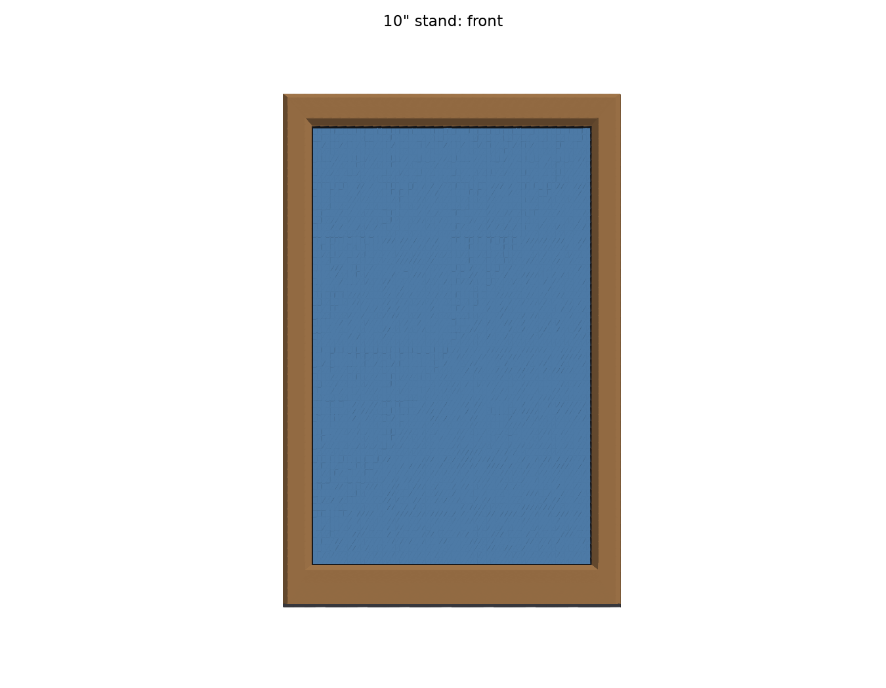
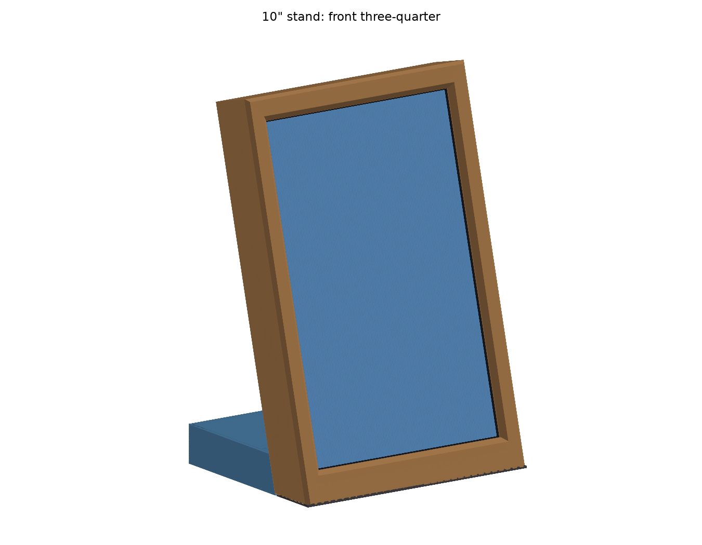
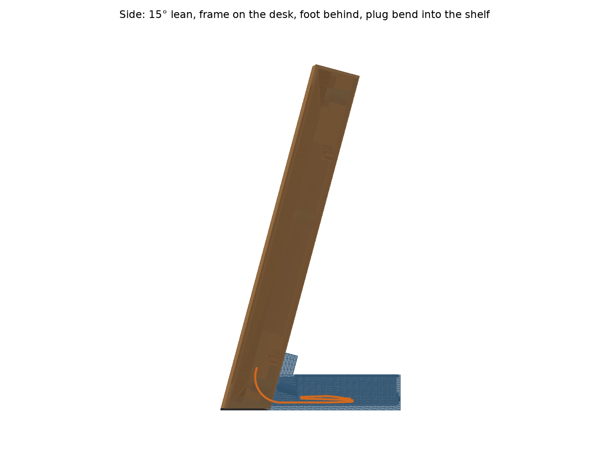
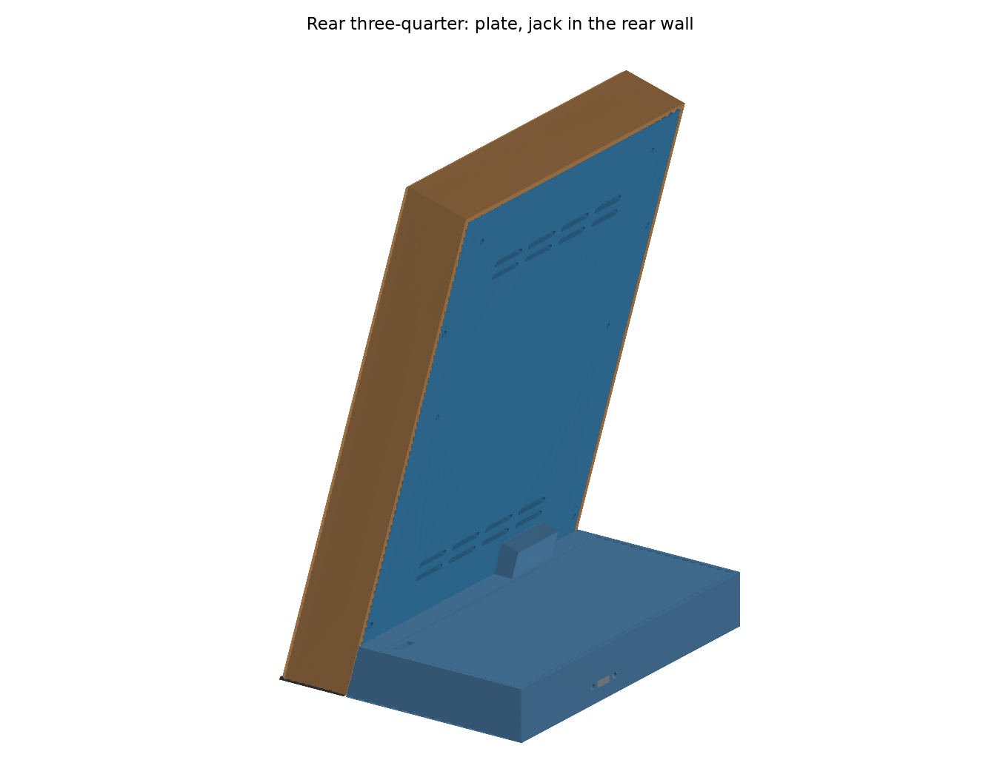
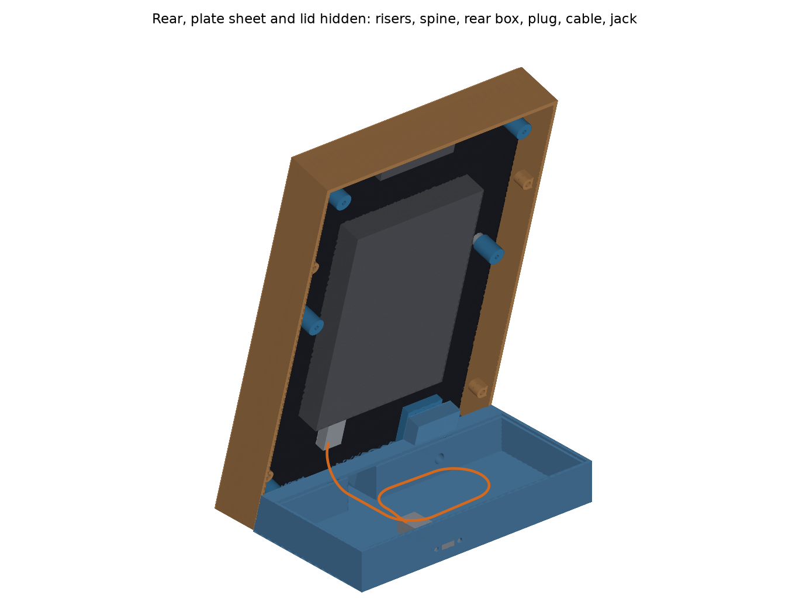
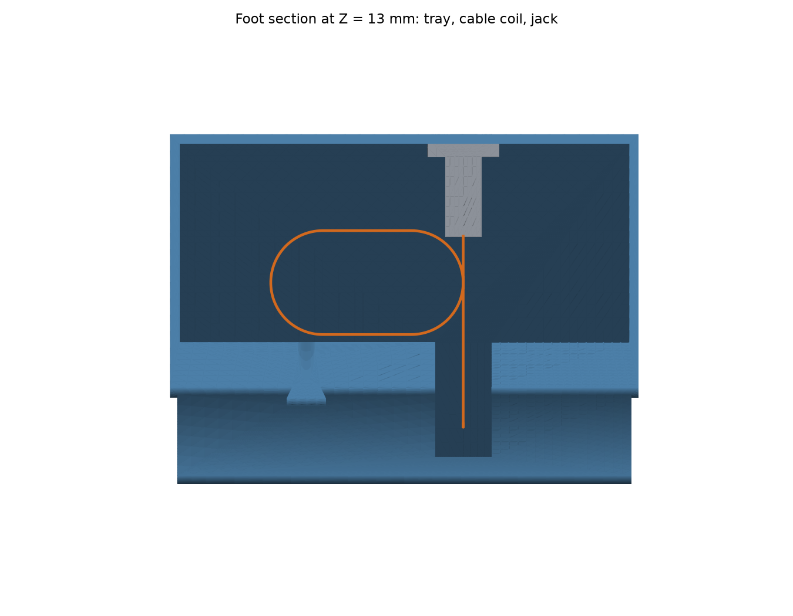

# Espframe 10" portrait desk stand

A 3D-printable portrait desk stand for the 10" espframe (Guition ESP32-P4 JC8012P4A1, 800 × 1280, about 550 g), with a wood-look picture frame round the screen. It follows the 7" stand in [`../stand`](../stand/README.md) (COM-363 and its follow-ups) and reuses its measured fits, cable and jack. It's a parametric Python model built with [build123d](https://github.com/gumyr/build123d): one command rebuilds every print file, the preview images and a set of fit and stability checks (COM-396). Background notes and sources are in [docs/background.md](docs/background.md).

| | |
|---|---|
|  |  |
|  |  |
|  |  |

Overall 164 W × 127 D × 245 H mm. The screen leans back 15° and pushing it back at the centre takes 4.99 N to tip it (target 4.5).

## How it works

- **On the desk.** There's one variant, like the 7"'s on-desk one (COM-442): the frame stands on felt on the desk, and the foot behind it holds the lean through a dovetail. The shell's bottom edge sits 7 mm off the desk, as low as the straight plug's R18 bend allows (1.7 mm to spare).
- **Picture frame (wood-look PLA).** The outer edge sits tight to the shell (2.7 mm outside it), and the face runs in over the whole black glass border to the picture, so only the picture shows, with a 0.75 mm reveal. Faces are 13.6 mm at the sides and 15.1 at the top; at the bottom the face runs down to the desk, a 20 mm border.
  - It's 164.1 × 253.1 mm printed face-down, within the P1S's 256 bed by 2.9 mm. A lower screen would need a shorter plug; a higher one would make the frame too tall to print in one piece.
  - It hangs on the back-plate: four M3 × 8 screws from behind, through the plate's edges, into inserts in bosses on its side walls. There's no bottom wall (as the 7", COM-431). It never touches the glass: felt on the back of the face stays 0.2 mm off it.
- **Back-plate (3 mm PETG), closed, behind the rear box.** Six printed risers (Ø10 × 12.7) stand on the board's six bosses (short black standoffs with brass M2.5 inserts) and carry the plate 2 mm behind the rear box. Each riser has a 1 mm recess that drops over its boss, so the plate can't slide on its screws. Vent slots run in two rows low and two near the top.
- **Foot (PETG).** The plate's dovetail groove (in a spine left of the USB-C bank) slides down onto a rail on the foot's post. The cable drops through a notch in the plate's bottom edge and a slot in the shelf between the frame's side walls, runs through a tunnel into the tray, lies as one loose coil, and ends at the Poyiccot panel jack in the rear wall. The tray has a click-in lid, as on the 7".
- **Power and data.** The same Poyiccot USB 3.1 straight panel-mount extension (30 cm) as the 7". Its plug goes into the board's **USB_UART** port (the USB-C beside the white TX/RX/GND header), so any USB-C charger powers it and you can flash or read logs through the stand.
- **Antenna.** The C6's antenna window is near the top-left corner seen from the front (centre 23 mm from the top and from that edge). Only PETG covers it: the screw nearest it is nylon, and every other screw and insert stays at least 15 mm away (checked).
- **Orientation.** The ribbon-cable end goes up and the USB-C end down, by the foot. Pick the matching portrait rotation in the espframe settings (COM-362).

## Measured on the board

| Value | Measured | Was (drawing or estimate) |
|---|---|---|
| Mounting holes | 15 from each edge, middle row 105 from the top | same |
| Brass insert depth | 4.4 | — |
| Body, glass front to flat back | 8.2 | 7.0 |
| Glass | flush with the shell rim | — |
| Rear box | 90 × 138, 15.2 proud of the back, centred | 93.5 × 138.35 × 15.51 |
| Box end face (USB-C mouths) | 54 above the shell bottom | 45–53 |
| USB_UART port | centre 100.0 across from the left seen from the front; 3.6 off the back | photo estimate |
| Bezels | about 12 at the sides, 13 top and bottom (the listed 135.36 × 216.58 picture, centred) | 12.9 / 10.6 / 11.7 / 14.6 scaled |
| Antenna window | centre 23 from the top and 23 from the left seen from the front (size estimated 18 × 25) | — |

Still estimated: the plug and cable (the 7"'s listing values: 27.5 mm out of the port, 12.5 × 6.5, Ø4.5, R18), the antenna window's size, and the printed parts' weights (`PRINT_FILL`, `FRAME_FILL`).

## Download the print files

Every merge to `master` that changes the stand attaches `espframe-stand-10-<version>.tar.gz` to that build's [GitHub release](https://github.com/rcompton78/compton-diy/releases). It holds the 3MF/STL/STEP files for every part, `checks.txt`, this README and the renders. CI only publishes it when every check passes.

## Building

```bash
pnpm nx run espframe-stand-10:cad
```

This creates (or refreshes) a local Python venv (`setup.sh`, Python 3.10–3.13, pinned `requirements.txt`) and runs `python -m stand10.build`, which:
- builds every part and writes `out/espframe-10in-stand-<part>.{stl,3mf,step}` (`out/` is gitignored);
- runs the checks below, writes `out/checks.txt`, and exits non-zero if any fails;
- renders the preview PNGs into `docs/`.

`pnpm nx run espframe-stand-10:release` runs `cad` and packs the tarball into `dist/espframe-stand-10/` (`scripts/pack-hardware-release.sh`, which refuses to pack on any `FAIL`). On merge to `master`, `.github/workflows/release.yml` runs it on the self-hosted runner, with the venv cached outside the checkout.

Every dimension is a named constant in [`stand10/params.py`](stand10/params.py), tagged `MEASURED`, `SOURCED`, `DESIGN` or `EST`.

## Checks

`out/checks.txt`:

| Check | Result |
|---|---|
| Plate clears the rear box | 2.00 mm behind its back face |
| Risers seat on the bosses | recess floor on the boss tops, no overlap with the board; rims 3.5 mm off the flat back |
| M2.5 × 20 engagement | 15.7 mm stack + 0.5 washer: 3.8 mm into the 4.4 mm insert. Without the washer it's 4.3, 0.1 from bottoming: always fit the washer |
| No metal near the antenna window | nearest metal 25 mm away (need ≥ 15); nylon screw in the top-left hole |
| Dovetail clearance | 0.02 mm per side on the flanks (the 7"'s printed coupon), no interference |
| Dovetail groove ends inside the spine | 2 mm of solid spine above the groove end (the 7" groove once cut through the plate) |
| Dovetail engagement | 30.8 mm (need ≥ 30) |
| Plug clear of the plate, frame, foot and board | no overlap |
| Cable | R18 bend, 261 mm of 300, a cable radius clear everywhere, 1.7 mm of straight drop to spare |
| Tip-over push at the screen centre | **4.99 N** (need ≥ 4.5), 836 g total (board 550); sideways tip at 38° |
| Plug passes the tunnel and deck slot | 3.75 mm per side in the 20 mm tunnel and slot (the plate notch is 20 too), for slack in the USB_UART position |
| Lid detents | as the 7": snap in, 1.25 mm of rear wall left, no overlap once seated |
| Jack, receptacle and jack screws | the 7"'s measured thin-wall mount, flush receptacle; the screw heads leave 11 mm for a charger plug moulding |
| Foot-lock screw (optional) | M3 × 12, 5.8 mm into an M3 × 4 insert; its counterbore runs on as an access bore that opens into the tray (the post's back is inside the foot body) |
| Frame opening | 0.75 mm reveal all round; only the picture shows head-on |
| Frame never touches the board | closest 0.70 mm; felt 0.20 mm off the glass |
| Picture centred across the frame | faces 13.62 / 13.62 / 15.06 mm, bottom border 20 mm |
| Frame bottom on the desk | face and side walls cut level on 1 mm felt; the frame clears the foot by 0.2 mm |
| Plug bend and plate clear the shelf | a cable radius off the shelf; plate 0.6 mm above it |
| Frame and foot share a centre line | equal overhang |
| Every part fits the P1S bed | yes (frame 164 × 253 × 34) |

The tip-over figure uses the modelled volumes, each material's density and an estimated fill fraction (`PRINT_FILL` 0.55 for PETG, `FRAME_FILL` 0.85 for the frame), plus the 550 g board. Weigh the printed parts and update the fills to tighten it.

## Parts to print

Structural parts are PETG on the stock Bambu P1S profile with the 0.4 mm nozzle; the frame is wood-look PLA (the 7" README's wood-look notes apply). **Print the template and riser coupons first.**

| File | Orientation | Settings |
|---|---|---|
| `coupon-template` | Flat as exported | 1.2 mm, 100% infill. Lay it on the board's flat back: the six rings should drop over the six bosses, the band should sit round the rear box with about 1 mm to spare, and the USB_UART port should sit inside the 20 mm notch in its bottom edge (the cable opening's width, so it shows the margin). It's mirrored, as seen from the back. |
| `coupon-riser` | As exported: plate square on the bed, riser up | As the plate. It should drop over a boss, and an M2.5 × 20 + washer should pull it down snug without bottoming. |
| `coupon-receptacle` | Flat | Optional: the jack is the 7"'s, so plate 2 (1.2 mm) should end flush with its receptacle. |
| `coupon-dovetail` | As exported (rail blocks standing on end) | Optional: the 7"'s 0.02 / 0.03 / 0.04 fit, already settled at 0.02 on this printer. |
| `plate` | As exported: back face on the bed, risers and spine up | 4 walls, 40% infill, 0.2 mm layers |
| `foot` | As exported: upright on its base | 4 walls, 25% infill, no supports |
| `lid` | Flat | 3 walls |
| `frame` | As exported: face down, walls and bosses up; 45° bevel and chamfer, no supports | Wood-look PLA, 3 walls, 20% infill |

## Bill of materials

| Qty | Part | Notes |
|---|---|---|
| 1 | Poyiccot USB 3.1 Type-C panel-mount extension, straight male to female, 30 cm | Into the board's USB_UART port |
| 5 | M2.5 × 20 pan head + M2.5 washer, steel | Plate to the board's brass inserts. **Always fit the washer** |
| 1 | M2.5 × 20 pan head + M2.5 washer, **nylon** | The top-left hole seen from the front (top-right from the back), next to the antenna window |
| 4 | M3 × 8 pan head + M3 washer | Plate to the frame |
| 4 | M3 × 4 × 4.2 heat-set inserts | Frame side-wall bosses |
| 1 | M3 × 4 × 4.2 heat-set insert + 1 M3 × 12 | Optional foot lock (plate spine) |
| 1 | 1 mm adhesive felt, ≈ 780 × 8 mm | Back of the frame face, over the black glass border only |
| 1 | 1 mm adhesive felt, ≈ 164 × 5 mm plus two ≈ 2 × 34 mm strips | Under the frame face's bottom and the side walls' bottoms |

The foot stands straight on the desk: no rubber feet (they'd lift the shelf towards the plate, which has 0.6 mm to spare).

## Assembly

1. **Inserts.** Four M3 × 4 inserts into the frame's side-wall bosses at PLA temperature (about 190–200 °C); the optional foot-lock insert into the plate spine from the groove floor at PETG temperature (220–240 °C).
2. **Felt.** The 8 mm strip on the back of the frame face, over the black border, its inner edge at least 1 mm outside the opening. The narrow strips under the frame's bottom edge, along the face and the two side walls, trimmed flush.
3. **Jack.** Lid off, set the jack inside the tray against the rear wall, receptacle outwards, and fit its own two screws from outside.
4. **Cable.** One loose coil in the tray, left of the jack, no tighter than about 40 mm across. Run it forward through the tunnel and push the plug up through the shelf slot (both 20 mm wide).
5. **Plate.** Lay the board face down on a soft cloth. Set the plate on it so each riser's recess drops over a boss, the spine and groove at the USB-C end. Screw it down with five steel M2.5 × 20 + washers and the **nylon** one in the hole by the antenna. Snug, don't crank: the threads are brass inserts in plastic standoffs.
6. **Frame.** **Screw the frame to the plate now, before the plate goes on the foot**: the dovetail is a free slide, and the frame on the desk sets the height. Lower the frame over the screen and fix it with four M3 × 8 + washers through the plate's edge holes. Check the even border and that the felt only rests on the black border.
7. **Plug and mount.** Plug the straight plug into USB_UART. Lower the plate's groove onto the foot's rail and let it slide down until the frame's felt meets the desk, with the foot standing on the desk too. The lead runs down through the plate's notch and the shelf slot. Optionally, with the lid off, fit the foot-lock M3 × 12 from inside the tray, through the access bore in the tray's front wall, into the plate spine's insert. Fit the lid front edge first, then press the rear edge down until it clicks.
8. **Rotation.** In the espframe settings, pick the portrait rotation that shows the picture upright.

## Open items

- **Plug and cable:** the 27.5 mm plug length outside the port, its 6.5 mm thickness and the 4.5 mm cable are the 7"'s listing values. The bend has 1.7 mm of drop to spare: test-fit the real plug and cable under the printed foot's shelf before printing the frame. If it's tight, raise `SHELL_Z` (each mm up adds about 1 mm of drop, and lengthens the frame by about 1 mm, which has 2.9 mm left on the bed).
- **Antenna window size:** estimated 18 × 25 mm round its measured centre.
- **Weights:** weigh the printed parts and update `PRINT_FILL` / `FRAME_FILL`; tip-over has 0.49 N to spare.
- **Frame look:** print it and check the border on the real panel; tune `REVEAL` if a black line shows.
