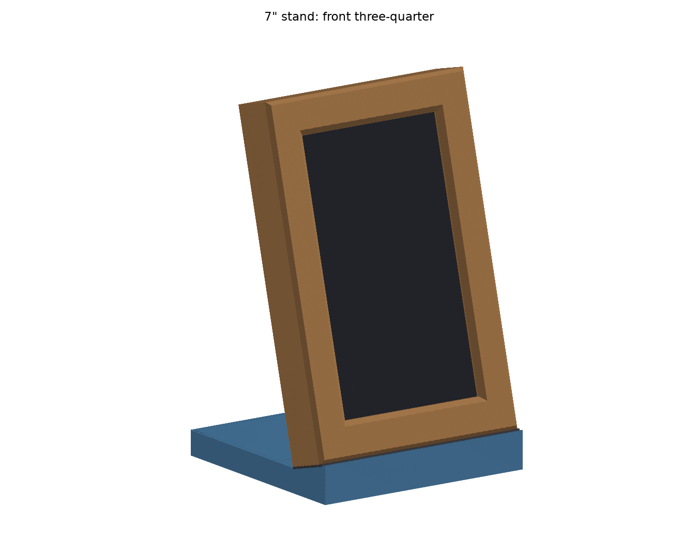
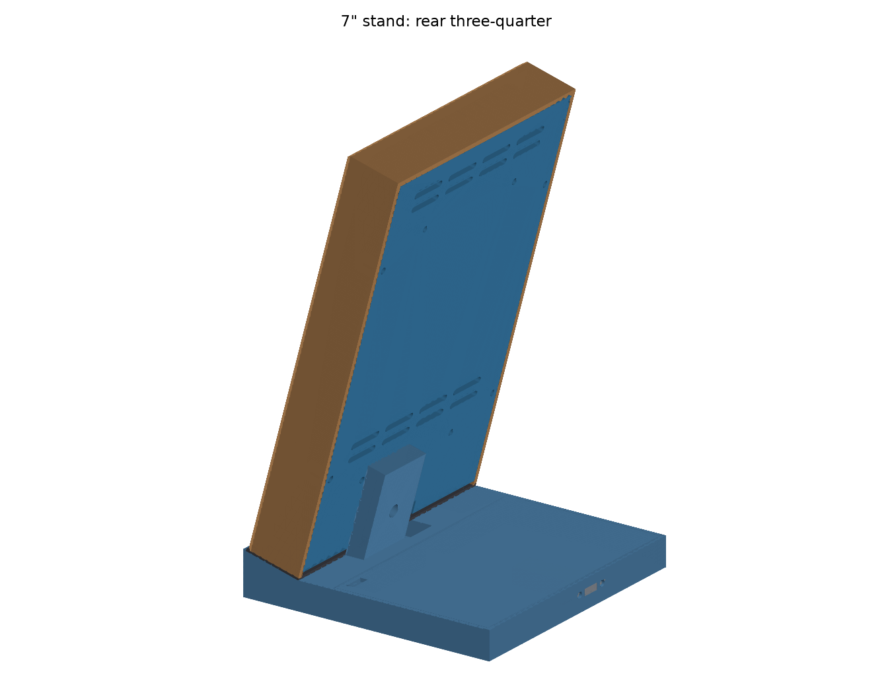
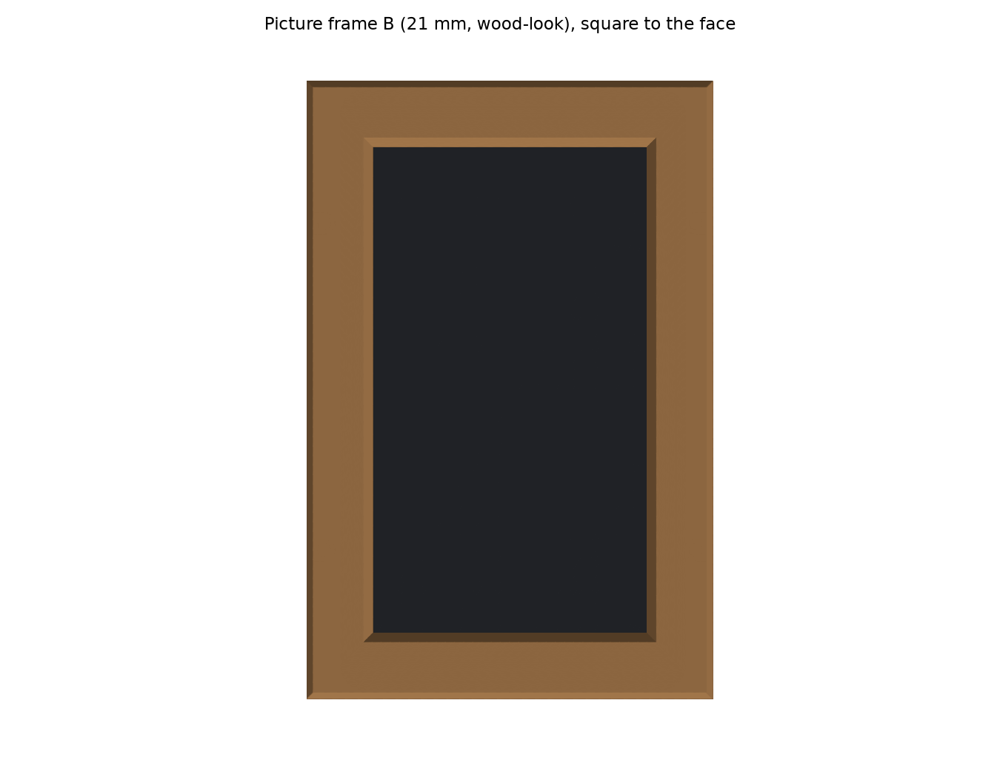
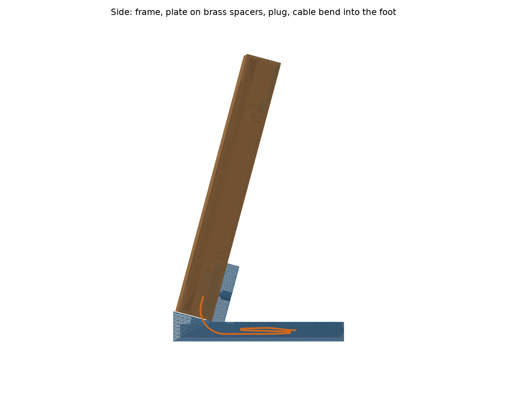
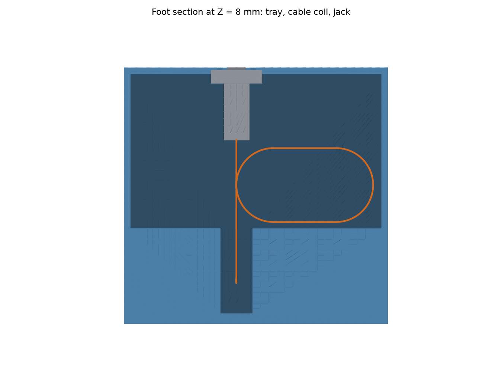
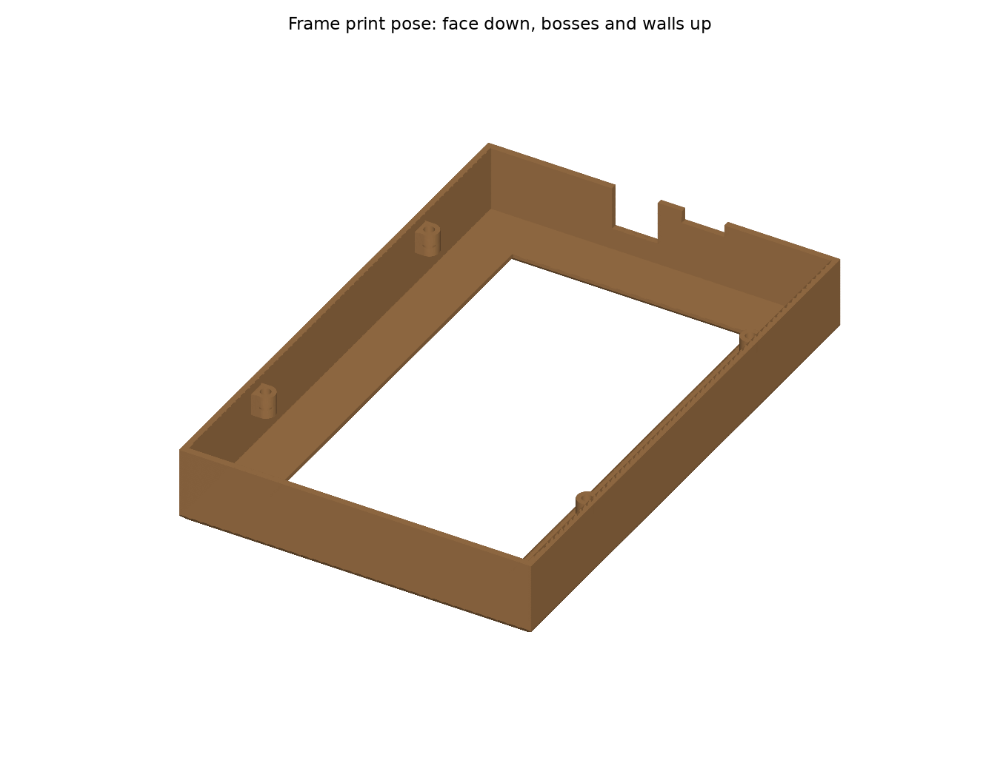
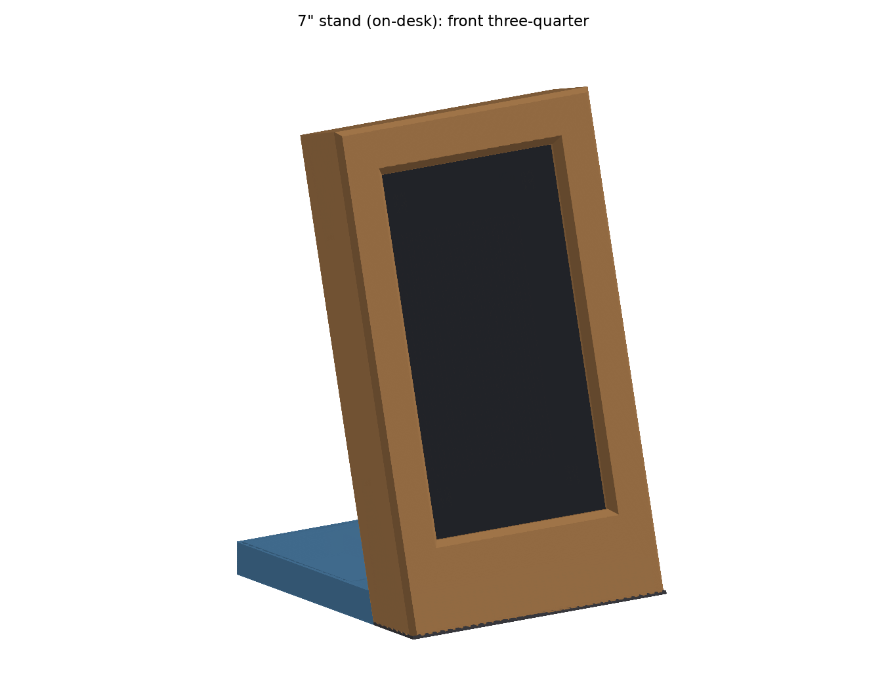
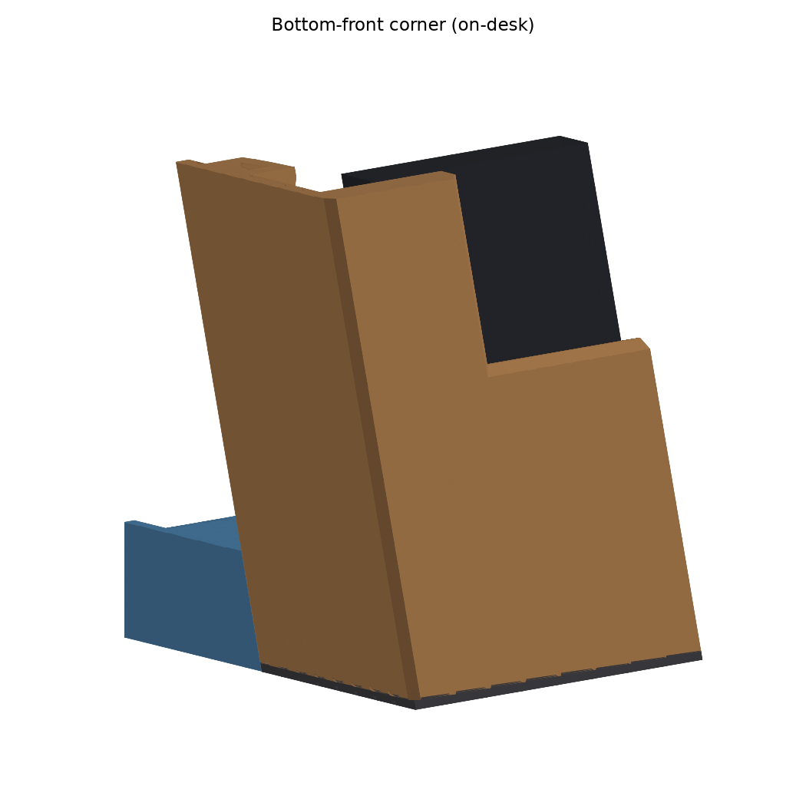
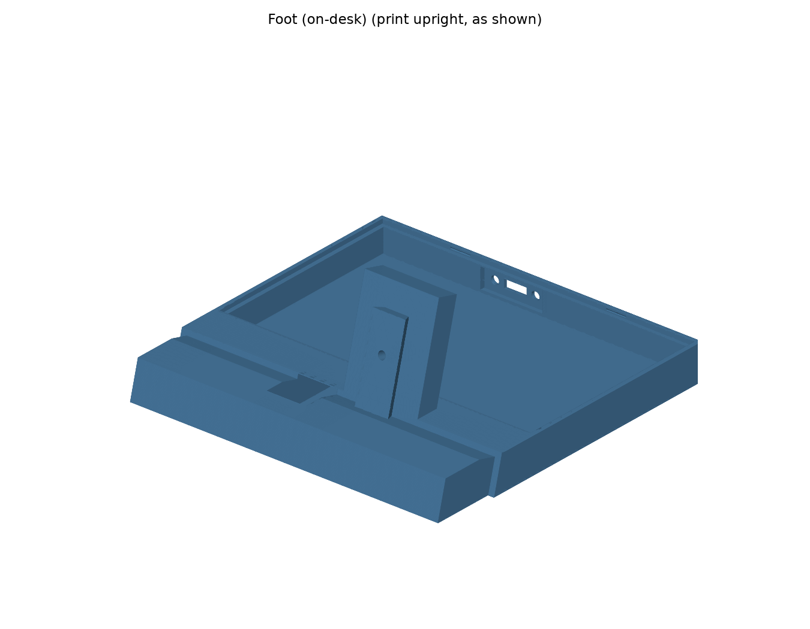

# Espframe 7" portrait desk stand

A 3D-printable portrait desk stand for the 7" espframe (Waveshare ESP32-S3-Touch-LCD-7, Rev1.2), with a wood-look picture frame round the screen. It's a parametric Python model built with [build123d](https://github.com/gumyr/build123d). One command rebuilds every print file, the preview images, and a set of fit and stability checks. It comes in two variants (see below): the frame sits on a ledge on the foot, or stands on the desk in front of it. The 10" Guition version is its own project in [../stand-10](../stand-10/README.md) (COM-396).

| | |
|---|---|
|  |  |
|  |  |
|  |  |
|  |  |
|  |  |

## Two variants

Both are built from the same model (`STAND_VARIANT=ledge|desk`, see Building) and share the plate, the lid, the cable and the jack. Pick one.

| | Ledge | On-desk |
|---|---|---|
| Frame sits on | felt on a 20 mm ledge on the foot | felt on the desk, in front of the foot |
| Glass bottom above the desk | 23.6 mm | 19.0 mm |
| Bottom border of the frame | 21 mm, like the other three sides | about 38 mm (21 on the other three) |
| Tip-over push at the screen centre | 4.28 N | 4.39 N |
| Plug bend drop to spare | 4.9 mm | **0.1 mm**: test-fit the real plug and cable first |
| Frame print | `frame` (130 × 198 mm) | `frame-desk` (130 × 216 mm) |
| Foot print | `foot` | `foot-desk` |
| Shared prints | `plate`, `lid`, coupons | `plate`, `lid`, coupons |

The on-desk foot has no ledge: its body starts just behind the plate, and a low shelf between the frame's side walls carries the deck slot and the plug's bend. The shelf stops 0.5 mm behind the frame face and 0.6 mm under the plate's bottom edge, so the frame (which carries the device on the desk) never bears on the foot. The screen can't come lower than about 19 mm with this straight plug: its R18 bend under the screen sets the floor.

## How it works

- **Picture frame (wood-look PLA).** Style B, classic bevel, with a 21 mm face.
  - The opening is the picture area plus a 0.75 mm reveal (88.22 × 156.38), and the face is the same width all round. That hides the panel's uneven black bezel (11 / 13 / 19 / 19 mm) behind an even border, so the frame sits 1 mm right of the glass centre.
  - The face is 4 mm thick, with a 45° × 3 mm bevel into the opening and a 2 mm outer chamfer round the top and sides. Its bottom edge is square, so the face comes right down to the ledge.
  - The frame hangs on the back-plate: four M3 × 8 screws from behind, through the plate's edges, go into inserts in bosses on its side walls. The walls run down the sides and across the top only. There's no bottom wall: the bottom edge of the face and the ends of the side walls sit on felt on the foot's ledge.
  - It never touches the glass. 1 mm felt on the back of the face stays 0.2 mm off the glass, and the walls clear the side and top glass edges by ≥ 0.7 mm.
- **Back-plate (3 mm PETG).** It screws to the four M3 brass spacers that Waveshare already fits to the panel (8 mm, on ~2 mm tabs, tops at 10 mm).
  - Four printed risers (Ø9 × 4.5) sit on the spacers, lifting the plate to 14.5 mm above the panel back. That clears the tallest part, the 12 mm UART2 JST, by 2 mm (designed to 12.5).
  - It fills the frame out to its walls (0.3 mm clear), so the back is closed at the sides and top, with a 2.3 mm gap left along the bottom between the plate edge and the ledge felt (the frame has no bottom wall since COM-431), and carries the frame on four screws near its side edges.
  - Two rows of vent slots low down and two near the top (4 slots of 20 × 3 mm each) let air through, since the back is otherwise closed.
- **Foot (PETG).** The plate slides down onto a dovetail rail on the foot's post, and the frame's face settles on the felted ledge (20 mm high). In the on-desk variant the frame stands on felt on the desk instead, and the foot only holds the lean through the dovetail. The screen leans back at 15°, like a desktop picture frame (10° before COM-417).
  - It's centred on the frame, not the glass (COM-442), so the frame lines up with both ends of the foot.
  - No ballast: the printed stand was sturdy without it, and the front under the ledge is solid. The foot is 120 mm deep.
  - The tray is open on top and closed with a lid that clicks in: two small ridges on each long edge snap into grooves in the tray's rim. Prise it out at the slot in its front-right corner.
- **Power and data.** A Poyiccot USB 3.1 panel-mount extension (straight, 30 cm) passes every pin through:
  - Its plug goes into the board's UART (CH343) USB-C port.
  - The lead drops through a notch in the plate, past the open bottom of the frame and through the deck slot, bends at R18, lies as one loose coil in the tray, and ends at the panel jack in the rear wall.
  - Any USB-C charger works, and you can flash or read logs through the stand without taking it apart.
- **Orientation.** The board's USB edge goes down: the landscape panel turned 90° counter-clockwise, seen from the front. Pick the matching rotation in the espframe settings (COM-362).

## Changes in COM-442

- **Foot centred on the frame.** The foot was centred on the glass, but the frame follows the picture area, which sits 1 mm left of the glass centre. On the printed stand, the frame overhung the foot's left end by 1.1 mm and the foot stuck out 0.9 mm past the frame on the right. The foot (130 mm wide) is now centred on the frame (130.2 mm), so the frame overhangs by 0.11 mm at each end. A new check keeps the two on one centre line.
- The foot's outline, tray and lid rabbet move 1.02 mm left. The dovetail post, cable tunnel, deck slot and jack stay where they were under the screen. Every other check result is unchanged. The coil keeps 1.9 mm to the tray's right wall (was 2.9).

**What to reprint:** only the foot. The lid only moves with the tray and its shape is unchanged, so keep yours. The frame and plate don't change.

- **On-desk variant (new).** A second variant, alongside the ledge one: the frame's face and side walls run down to 1 mm felt on the desk with a level bottom, and the foot loses the ledge for a low shelf under the glass. The glass comes down from 23.6 to 19.0 mm, the bottom border grows to about 38 mm, and tip-over improves to 4.39 N. Same straight cable: its R18 bend now has only 0.1 mm of drop to spare. The deck, tray and lid keep the ledge foot's heights, so the lid is shared.

**To build the on-desk variant:** print `frame-desk` and `foot-desk`, and reuse your plate and lid. Test-fit the plug and cable under the shelf before anything else (see Open items).

## Changes in COM-431

- **No bottom wall on the frame.** The 2 mm bottom wall, and its cable and dovetail notches, had to fit between the ledge and the glass's bottom edge with only 0.7 mm to spare, and on the printed stand it didn't. The frame now has walls down the sides and across the top only. The face's bottom edge and the side walls sit on the ledge felt, and the device still hangs on the plate's dovetail, so the screen sits at the same height as before (dovetail engagement unchanged at 31.8 mm).
- **Square bottom edge.** The outer chamfer now runs round the top and sides only, so the face sits flat on the ledge with no notch and looks closer to the base.
- **Tip-over limit 4.25 N** (was 4.3). The frame is about 5 g lighter, which takes the push to tip the stand back from 4.32 to 4.28 N. Reprinting a 1 mm deeper foot to win that back wasn't worth it.
- **Assembly order matters** (step 6 below). Screw the frame to the plate before mounting it. The dovetail is a free slide, and the frame on the felt is what sets the plate's height. Mounted without the frame, the plate slides 2.3 mm further down until its bottom edge lands on the felt, and the frame's screw bosses then sit 2.3 mm above the plate's holes.

**What to reprint:** only the frame. A printed COM-417 frame with its bottom wall cut off flush works the same, apart from the outer chamfer still on its bottom edge.

## Changes in COM-417

- **15° lean** (was 10°). The ledge is 2 mm higher (20 mm) so the deck and lid stay clear of the cable coil, and the foot is 120 mm deep (was 118).
- **Wider plug path.** The cable tunnel through the foot was 12 mm wide, narrower than the 12.5 mm plug. The tunnel and the deck slot are now 16 mm wide, and the cable notches in the plate and frame are 16 and 17 mm (the frame's went with its bottom wall in COM-431).
- **The lid clicks in** on printed detents instead of just resting in its rabbet.

**What to reprint:** the foot and lid. The plate and frame only gained wider cable notches (+2 mm), so reprinting them is optional: keep yours if the lead already drops through them easily.

## Download the print files

Every merge to `master` that changes the stand attaches `espframe-stand-<version>.tar.gz` to that build's [GitHub release](https://github.com/rcompton78/compton-diy/releases). Look for the newest release titled "Print files …" or "Release …" with that asset. The tarball holds the 3MF/STL/STEP files for every part, `checks.txt`, this README and the preview renders. CI only publishes it when every check below passes.

## Building

```bash
pnpm nx run espframe-stand:cad
```

This creates (or refreshes) a local Python venv (`setup.sh`, Python 3.10–3.13, pinned `requirements.txt`) and then runs `python -m stand.build`, which builds both variants, each in its own process (`STAND_VARIANT=ledge|desk python -m stand.build --variant <v>` builds just one). For each, it:
- builds every part and writes `out/espframe-7in-stand-<part>.{stl,3mf,step}`. The on-desk frame and foot get a `-desk` suffix, and the shared parts are written once. `out/` is gitignored;
- runs the checks below, writes `out/checks.txt`, and exits non-zero if any check fails;
- renders the preview PNGs into `docs/` (`-desk` suffix for the on-desk ones). These are committed so this README shows them.

`pnpm nx run espframe-stand:release` runs `cad` and then packs the tarball into `dist/espframe-stand/` (`scripts/pack-hardware-release.sh`, which refuses to pack if `checks.txt` has any `FAIL`). On merge to `master`, `.github/workflows/release.yml` runs it on the self-hosted runner, with the venv cached outside the checkout, and attaches the tarball to the GitHub release.

The targets aren't called `build`, `test` or `install`, so PR CI, the firmware builds and `pnpm install` never download build123d's ~150 MB of CAD libraries.

Every dimension is a named constant in [`stand/params.py`](stand/params.py), tagged `MEASURED`, `SOURCED`, `DESIGN` or `EST`. Change a value and re-run the target. Material densities are parameters too: `PETG_DENSITY` for the structural parts, and `FRAME_DENSITY` for the wood-fill frame.

## Checks

`out/checks.txt` has a section per variant, plus a `shared` one comparing the two passes' lids. Ledge:

| Check | Result |
|---|---|
| Plate clears the UART2 JST keep-out (whole PCB footprint up to 12.5 mm) | 2.00 mm (need ≥ 2.0) |
| Risers seat on the brass spacer tops | exact, no overlap |
| M3 × 12 engagement in the spacer | 4.5 mm of 6–7 mm thread (M3 × 14 would be borderline) |
| Dovetail clearance | 0.02 mm per side on the angled flanks (set from the printed coupon), no interference; flat plate-to-post gap 0.2 mm |
| Dovetail engagement | 31.8 mm of the 35.5 mm rail (need ≥ 30; the frame raises the screen 3.7 mm above the ledge) |
| Plug clear of the plate, frame and foot | no overlap |
| Cable bend radius | tightest 18.0 mm (limit R18, est.) |
| Cable length | 267 mm path of 300 mm (33 mm slack) |
| Cable clearance along its length | ≥ cable radius everywhere |
| Plug bend fits above the tray floor | 4.9 mm of straight drop to spare (rev D without the frame had 1.9) |
| Plug passes the tunnel and deck slot | 12.5 × 6.5 plug: 1.75 mm per side in the 16 mm tunnel and the 16 mm slot (need ≥ 1), 3.0 mm of tunnel height to spare |
| Lid detents | 4 ridges 0.3 mm high snap past 0.15 mm of interference into 0.25 mm grooves, leaving 1.25 mm of rear wall. Only the rear wall flexes: 0.15 mm with the front edge hooked in first, 0.30 if the lid is pressed in flat; no overlap once seated; lift slot clear |
| Tip-over: push at the screen centre to tip it back | **4.28 N** (need ≥ 4.25) at 15° and 120 mm deep, accepted in exchange for a shorter foot when the lean went to 15° (4.32 before COM-431 took the frame's bottom wall off). The 10° stand, 118 mm deep, was 4.5 N, and that print felt sturdy without ballast; rev A design was 3.2 N. A foot about 126 mm deep would hold 4.5 N at 15°. Sideways tip at 34°. Weight stuck under the front raises it (about +0.8 N per 100 g). |
| Frame opening clear of the picture | 0.75 mm reveal on every side (need ≥ 0.5) |
| Frame never touches the glass | closest 0.71 mm (need ≥ 0.5) |
| Glass edge gap L / R / T | 8.75 / 6.71 / 0.71 mm. The bottom is open (no bottom wall), with the ledge felt 2.71 mm below the glass |
| Face felt clears the glass | 0.20 mm, none over the picture |
| Only the picture shows through the opening | head-on, nothing but glass inside the opening: no frame, felt, plate, spacers or plug |
| Plate edges meet the frame bosses | flush contact, no overlap |
| Frame screw engagement | M3 × 8 through the 3 mm plate: 5 mm into a 6 mm hole with an M3 × 4 insert |
| Frame and foot share a centre line | the frame overhangs each end of the foot by 0.11 mm (need equal within 0.1) |
| Frame face seats on the ledge | square bottom edge of the face and the side walls on 1 mm felt; frame to foot never closer than 1.0 mm elsewhere |
| Jack fits its recess and window | measured flange 25 × 8 × 6.5 bears on the 1.2 mm web inside the rear wall; no overlap |
| Receptacle flush with the rear face | the metal USB-C receptacle (1.2 mm proud of the flange) pokes through a 9.3 × 3.7 window and ends flush |
| Jack screws from outside | the jack's own screws (16.5 mm pitch) pass 0.3 mm clear of its body. Their heads leave 11 mm between them, so a charger plug moulding wider than that can't seat fully: test yours |
| Foot-lock screw (optional) | M3 × 12 engages 5.8 mm in an M3 × 4 insert |
| Every part fits the P1S bed | yes (frame 130 × 198 × 28) |

On-desk, where it differs from the ledge (every other check gives the same result):

| Check | Result |
|---|---|
| Frame bottom on the desk | the face and both side walls are cut level and sit on 1 mm felt; glass bottom 19.0 mm off the desk; bottom border 38 mm |
| Frame clears the foot | closest 0.20 mm, no overlap: the frame carries the device on the desk |
| Plug bend clears the shelf | no plug overlap; the cable's bend stays a cable radius off the shelf; **0.1 mm** of straight drop to spare |
| Plate clears the shelf | 0.60 mm under the plate's bottom edge |
| Shared lid (in the `shared` section) | the lid each pass builds is identical (volume and box), and the lid detent check seats it in the desk foot too, so the one printed lid fits both feet |
| Cable length | 261 mm path of 300 mm (39 mm slack) |
| Tip-over | **4.39 N** (need ≥ 4.25); sideways tip at 35° |
| Every part fits the P1S bed | yes (frame 130 × 216 × 28) |

The tip-over figure uses the modelled part volumes, each part's material density and an estimated fill fraction (`PRINT_FILL` 0.55 for PETG, `FRAME_FILL` 0.85 for the thin frame), plus the 354 g screen. Weigh your printed parts and update the fill values to tighten it.

## Parts to print

Structural parts are PETG on the stock Bambu P1S profile with the 0.4 mm nozzle. The frame is wood-look PLA (see below).

- **Ledge variant:** `frame`, `foot`, plus the shared `plate` and `lid`.
- **On-desk variant:** `frame-desk`, `foot-desk`, plus the shared `plate` and `lid`.

| File | Orientation | Settings |
|---|---|---|
| `coupon-dovetail` | As exported: the groove block lies groove-down (like the plate), and the five rail blocks stand on end so each rail runs straight up (like the foot post). Don't lay the rails flat: their angled sides print as undersized steps and every fit reads too loose. | 4 walls. **Print first.** 1–3 notches on top of each rail block mark 0.02 / 0.03 / 0.04 mm clearance per side (round 3; round 2's 0.05 was closest but a touch loose). `coupon-dovetail-rails` is the rails alone, to reuse an already-printed groove block. Pick the tightest that slides through by hand and set `SLIDE_CLEAR` to it. The rail tip keeps 0.4 mm off the groove floor (`DOVE_TIP_CLEAR`) whatever the clearance, in case the bridged floor sags. |
| `coupon-receptacle` | Flat as exported | 100% infill, 0.2 mm layers. Three thin plates (1–3 notches = 1.0 / 1.2 / 1.4 mm), each a copy of the rear-wall web: receptacle window and two holes at the measured 16.5 mm flange pitch. Screw one onto the flange with the jack's own screws: the screws threading straight in confirms the pitch, and the plate the metal receptacle ends flush with sets `JACK_RECEPTACLE_PROUD` (plate 2, 1.2 mm). Plug your chargers into it to check the screw heads don't stop them seating. |
| `plate` | As exported: back face on the bed, risers and spine up. The dovetail groove's undercut faces the bed and prints without supports. | 4 walls, 40% infill (the risers end up solid), 0.2 mm layers |
| `foot` / `foot-desk` | As exported: upright on its base | 4 walls, 25% infill, no supports. |
| `lid` | Flat | 3 walls. If the detents are too stiff or too loose, tune `LID_DETENT_H` (0.3 mm). |
| `frame` / `frame-desk` | As exported: face down on the bed, walls and bosses up. The bevel and outer chamfer are 45° overhangs: no supports. The bottom end of the frame is open. | Wood-look PLA, 3 walls, 20% infill. See the wood-look notes. |

### Wood-look frame

- **Material.** Two good options:
  - **Bambu Lab PLA Wood** (real wood fibre) on a **0.6 mm nozzle**. Bambu's data sheet lists 0.4, 0.6 or 0.8 mm nozzles, but higher wood contents clog a 0.4 mm nozzle, so 0.6 is the safe choice. Use 0.28 mm layers.
  - **Polymaker PolyWood**, which gets its wood look from foamed PLA with no fibre, on the stock **0.4 mm** nozzle.
- **PLA is fine here.** Wood-fill PETG exists but is rare, and PLA does the job: the frame only carries the screen's ~0.45 kg down to the ledge in compression, plus four lightly tightened screws. The load-bearing parts (plate and risers, foot, lid) stay PETG.
  - PLA softens around 55–60 °C, so keep the stand out of direct sun and hot cars.
  - Use the spool's own temperature, and don't leave the nozzle idling hot: wood fibre chars and clogs.
- **Finish.** A smooth build plate gives a clean front face; a textured plate gives a matte grain. Wood fill can be sanded and stained.
- **Mass.** The frame is about 71 g in wood-fill PLA (`FRAME_DENSITY` 1.18 g/cm³; PolyWood is lighter).

## Bill of materials

| Qty | Part | Notes |
|---|---|---|
| 1 | Poyiccot USB 3.1 Type-C panel-mount extension, straight male to female, 30 cm | Plug into the board's UART (CH343) port |
| 4 | M3 × 12 pan head + M3 washers | Plate to brass spacers. Don't overtighten into the printed risers. |
| 4 | Waveshare stock M3 brass F-F spacers, 8 mm | Already on the panel; reused |
| 4 | M3 × 8 pan head + M3 washers | Plate to the frame |
| 4 | LUKAISEN M3 × 4 × 4.2 heat-set inserts (user's kit) | Frame side-wall bosses |
| 1 | LUKAISEN M3 × 4 × 4.2 heat-set insert + 1 M3 × 12 | Optional foot lock (plate spine) |
| 1 | 1 mm adhesive felt, ≈ 540 × 6 mm | Back of the frame face, over the black bezel only |
| 1 | 1 mm adhesive felt, ≈ 130 × 28 mm | Ledge variant: ledge seat under the frame's face and side walls |
| 1 | 1 mm adhesive felt, ≈ 130 × 5 mm plus two ≈ 2 × 24 mm strips | On-desk variant: under the frame face's bottom and the side walls' bottoms |
| 4 | Small rubber feet | Ledge variant only, under the foot. The on-desk foot stands straight on the desk: anything under it lifts the shelf towards the plate, which has only 0.6 mm to spare |

No heat-set kit? Buy an M3 assortment. Inserts go in with a soldering iron, pressed in square and flush. Use **220–240 °C for PETG** (plate, foot) and **about 190–200 °C for the PLA frame**. The wood-fill frame is more brittle than PETG, so snug its M3 × 8 screws and don't crank them. Hole size is `INSERT_HOLE_D` (OD − 0.2 = 4.0 mm); confirmed snug and flush in PETG on a test print. The wood-fill frame is untested; if its inserts go in loose or crack a boss, tune it there.

## Assembly

1. **Inserts.**
   - Four M3 × 4 inserts go into the frame's side-wall bosses, at PLA temperature.
   - If you're using the foot lock, one M3 × 4 insert goes into the plate spine from the groove floor.
2. **Felt.** Stick the 6 mm felt strip on the back of the frame face, on the band that covers the black bezel. Keep its inner edge at least 1 mm outside the opening (`FELT_INSET`) so it stays hidden at an angle. Ledge variant: stick the wide strip on the foot's ledge. On-desk variant: stick the narrow strips under the frame's bottom edge, along the face and the two side walls, trimmed flush.
3. **Jack.** With the lid off, set the jack inside the tray against the rear wall, receptacle outwards, so the flange drops into its recess and the receptacle pokes through the window. Fit the jack's own two screws from outside through the wall into the flange's threaded holes.
4. **Cable.** Lay the spare cable as one loose coil in the tray beside the jack, no tighter than about 40 mm across. Then run it forward through the tunnel and push the plug up through the deck slot. Both are 16 mm wide, so the 12.5 × 6.5 plug passes with 1.75 mm each side.
5. **Plate.** Screw the plate to the four brass spacers with M3 × 12 + washers. The spine and dovetail groove go to the bottom, near the USB edge.
6. **Frame.** **Screw the frame to the plate now, before the plate goes on the foot.** The dovetail doesn't stop the plate on its own: the frame resting on the ledge felt sets the height. Slid on without the frame, the plate drops 2.3 mm until its own bottom edge lands on the felt, and the frame's holes no longer line up with the plate's. Lay the screen face down on a soft cloth and lower the frame over it. Fix it with four M3 × 8 + washers from behind, through the plate's edge holes into the frame inserts. Check the even border, and that the felt only rests on the black bezel.
7. **Plug and mount.** Plug the straight plug into the board's UART USB-C. Lower the plate's groove onto the foot's rail and let it slide down until the frame's face sits on the felted ledge (on-desk: until the frame's felt meets the desk, with the foot standing on the desk too). The plug's lead runs down through the notch in the plate, past the frame's open bottom and into the deck slot.
   - Optionally, fit the foot-lock M3 × 12 from the back of the post.
   - Fit the lid front edge first, so its front ridges drop into their grooves, then press the rear edge down until it clicks. Only the thin rear wall flexes, and a lid pressed in flat makes it flex twice as far.
8. **Rotation.** In the espframe settings, pick the rotation (90 or 270) that shows the picture upright.

## Open items

These are estimated until the parts arrive. Each is a parameter in `stand/params.py`.

- **Poyiccot jack:** measured and confirmed on test prints (flange 25 × 8 × 6.5, threaded M3 holes 16.5 apart, body 12.5 × 8, 34.5 long, receptacle 1.2 mm proud). Still to check: your chargers seat fully between the screw heads.
- **Plug length:** confirm the 35 mm includes the 7.5 mm tip, so 27.5 mm sticks out.
- **Cable:** confirm the diameter (4.5) and that it takes an R18 bend without levering on the board's port. There's 4.9 mm of drop to spare under the plug on the ledge stand, but only **0.1 mm** on the on-desk stand: before printing its frame, test-fit the real plug and cable under the printed `foot-desk` shelf (if it's tight, raise `DESK_GLASS_Z`: each 1 mm up adds about 1 mm of drop, and lengthens the bottom border by the same).
- **UART port:** confirm which of the two USB-C ports is the UART (CH343) one, and that the pair is on the left edge seen from the front.
- **Weights:** weigh the printed parts, update `PRINT_FILL` / `FRAME_FILL`, and re-run to refresh the tip-over number.
- **Frame fit:** print the frame and check that the border looks even on your panel. Tune `REVEAL` and `FRAME_FACE_W` if needed.

Design history and sources: the desk-stand audit (plan revs A–D and the frame concept) and Linear COM-363.
