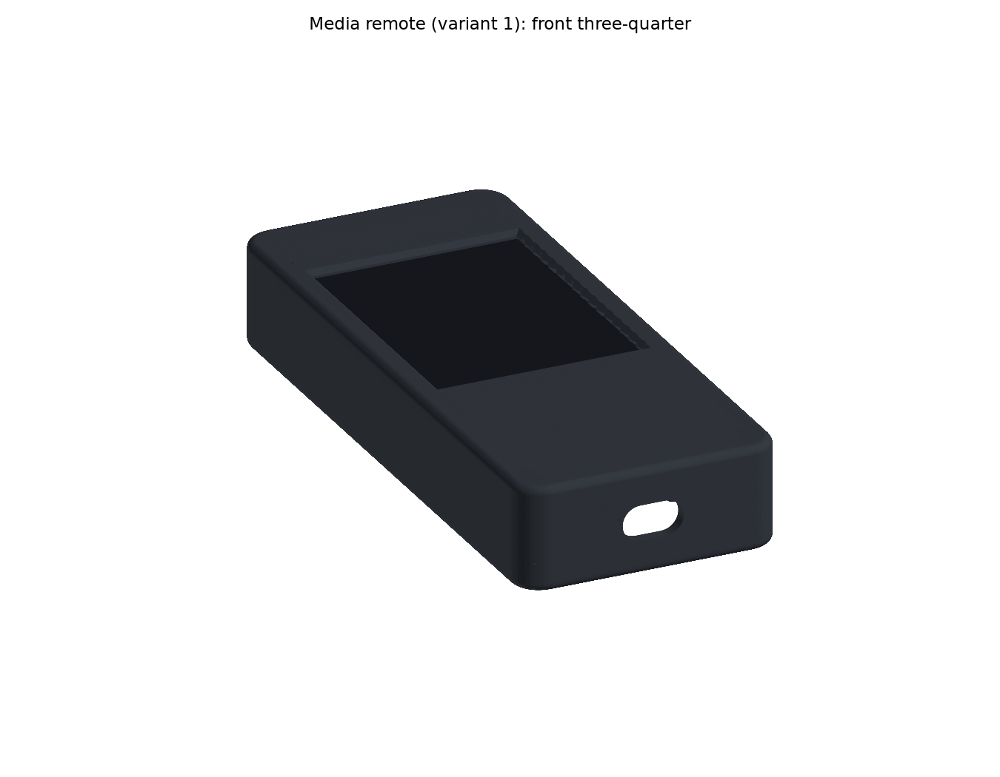
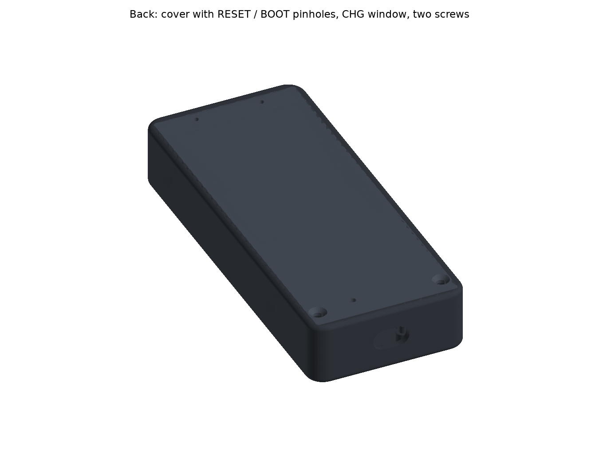
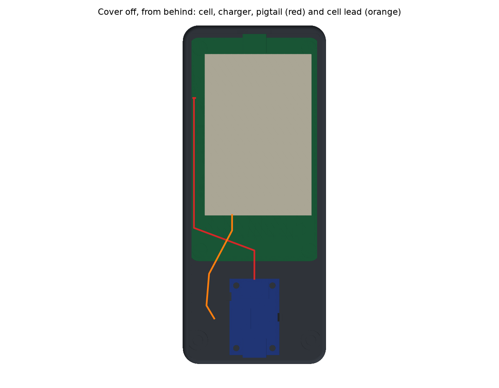
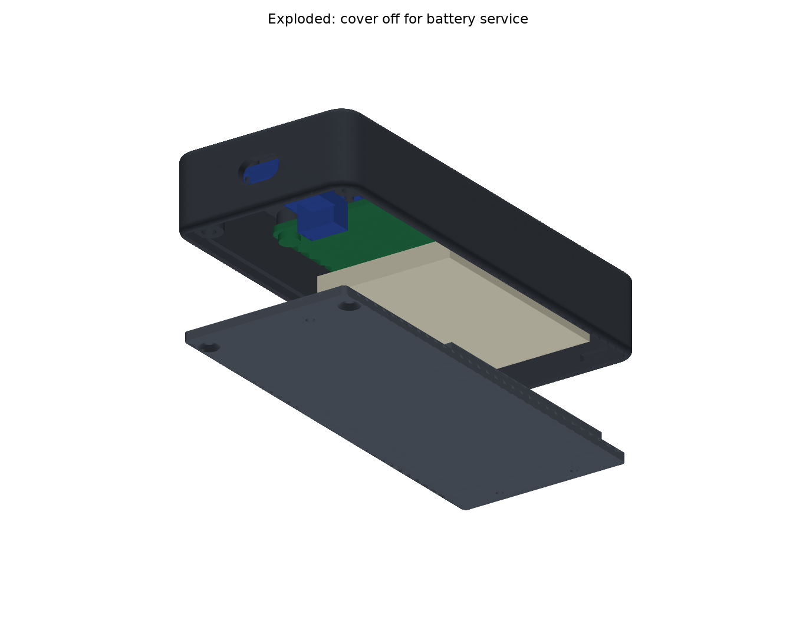
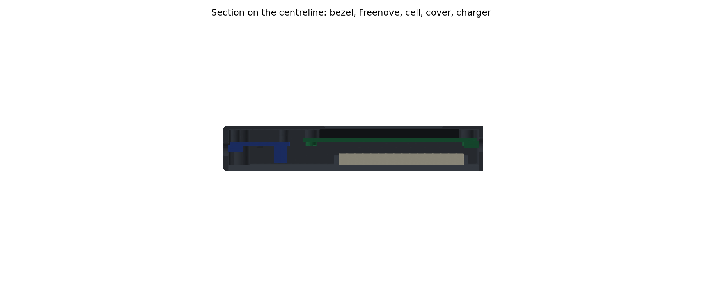

# Media room remote: handheld enclosure

A 3D-printable, TV-remote-shaped case for [`apps/media-room-dashboard`](../../README.md) running on battery: the Freenove ESP32-S3 2.8" CYD (FNK0104), an Adafruit BQ25185 charger (6092) and a 1200 mAh 504060 LiPo. It's a parametric Python model built with [build123d](https://github.com/gumyr/build123d), on the same pattern as the [espframe stand](../../../espframe/hardware/stand/README.md). One command rebuilds every print file, the preview images and a set of fit checks.

This is **variant 1**: the BQ25185 charger with no fuel gauge (build A of the remote's cable map, minus the gauge and the USB divider). Variant 2 (a MAX17048 gauge, plus either a VBUS divider on the BQ25185 or a swap to a BQ24074) isn't designed yet. See [Variants](#variants).

| | |
|---|---|
|  |  |
|  |  |



## How it works

Left and right are as seen from the front, with the screen upright.

- **Shape.** 55 × 130 × 22 mm. The screen sits in the top part, and a grip below it holds the charger. Plan corners are R6 and the front and back edges are rounded R1.6.
- **Front shell (PETG).** One piece, holding everything except the cell.
  - **Bezel.** The 1.5 mm front wall has a 43.6 × 58.05 opening: exactly the screen's visible window, 0.16–0.2 mm outside the lit pixels, with a 45° × 1 mm chamfer on the front. Its lip rests on the glass's black border (≥ 2.74 mm all round).
  - **Freenove.** It drops in face down onto four Ø6.4 bosses on its 42 × 78 hole pattern and is fixed with M3 × 6 screws from behind into M3 × 4 heat-set inserts. The boss faces stop the PCB so the glass floats 0.1 mm behind the bezel instead of being clamped.
  - **Charger.** It sits in the grip, component side towards the back. Four printed standoffs carry Ø2.2 pegs through its 2.5 mm holes, and two cantilever snap hooks catch its long edges (0.5 mm barbs, 1.8% strain on a snap).
  - **USB-C openings.** The charger's USB-C is the **charge port**, through the bottom end. The Freenove's USB-C is the **flashing port**, through the top end; it's at the top with the UI upright. Each opening is a 13 × 7.5 stadium, sized for a 12 × 6.5 cable overmold plus 0.5 mm, so the overmold reaches through the wall and the plug seats fully.
- **Back cover (PETG).** Opens for battery service without unscrewing either board.
  - Two tongues on its top edge hook into slots in the 3 mm top wall.
  - Two M3 × 8 countersunk screws at the bottom go into inserts in bosses merged into the side walls.
  - Between those, it rests on 45° ledges along both side walls.
- **Cell.** Taped to the cover inside a ribbed pocket: 1 mm clearance per side, and room for 10% swelling.
  - The pocket sits against the left wall, leaving a wire channel down the right.
  - It starts 15.5 mm up the Freenove from its antenna end, so the PCB antenna has no LiPo behind it.
  - The cell's front face is 1.5 mm behind the tallest part on the Freenove's back (the drawing's 4.7 mm max).
- **Wiring** (cable map build A):
  - **Pigtail.** The MX1.25 pigtail leaves the charger's `4.5V max` terminal along the remote, turns rearwards behind the Freenove's antenna end, runs up the right-hand channel beside the cell and plugs into the Freenove's `BAT` socket. About 96 mm of run.
  - **Cell lead.** The cell's JST-PH lead leaves between the two stubs of the pocket's bottom rib and drops into a bay beside the charger, which leaves room for the plug and the lead's turn. About 44 mm of run.
  - The `3.3V` terminal stays unused.
- **Extras in the cover.** Two Ø2 paperclip holes over the Freenove's RESET and BOOT buttons, so you can reach download mode without opening the case, and a Ø2.5 window over the charger's orange CHG LED.

## Download the print files

Every merge to `master` that changes the enclosure attaches `media-room-remote-enclosure-<version>.tar.gz` to that build's [GitHub release](https://github.com/rcompton78/compton-diy/releases). The tarball holds the 3MF/STL/STEP files, `checks.txt`, this README and the preview renders. CI only publishes it when every check passes.

## Building

```bash
pnpm nx run media-room-remote-enclosure:cad
```

This creates (or refreshes) a local Python venv (`setup.sh`, Python 3.10–3.13, pinned `requirements.txt`, the same pins as the espframe stand) and then runs `python -m remote.build`, which:
- builds both parts and writes `out/media-remote-v1-{shell,cover}.{stl,3mf,step}` in their print poses. `out/` is gitignored;
- runs the checks below, writes `out/checks.txt`, and exits non-zero if any check fails;
- renders the preview PNGs into `docs/`. These are committed so this README shows them.

`pnpm nx run media-room-remote-enclosure:release` runs `cad` and then packs the tarball into `dist/media-room-remote-enclosure/` with `scripts/pack-hardware-release.sh`. On merge to `master`, `.github/workflows/release.yml` runs it on the self-hosted runner, with the venv cached at `/hdd/compton-diy/venv-media-room-remote-enclosure`.

Every dimension is a named constant in [`remote/params.py`](remote/params.py), tagged `MEASURED`, `SOURCED`, `DESIGN` or `EST`. Change a value and re-run the target. Sources:
- **Freenove FNK0104:** it's LCDwiki's ES3C28P under another name. The outline drawing is on p13 of `Datasheet/ES3C28P_ES2N28P_Specification_V1.0.pdf` in [Freenove_ESP32_S3_Display](https://github.com/Freenove/Freenove_ESP32_S3_Display).
- **BQ25185:** Adafruit's Eagle board file in [Adafruit-bq25185-with-3.3V-Buck-PCB](https://github.com/adafruit/Adafruit-bq25185-with-3.3V-Buck-PCB).

## Checks

`out/checks.txt` has the full detail. With the current EST values:

| Check | Result |
|---|---|
| Freenove sits on its four bosses | on the 42 × 78 pattern; boss faces touch the PCB; glass floats 0.10 mm behind the bezel |
| Bosses clear the glass ends | 1.02 mm (need ≥ 0.5) |
| Shell and cover clear the Freenove's back parts | nothing inside the 4.7 mm keep-out over the whole PCB |
| Freenove screws and inserts | M3 × 6 reaches 4.4 mm into a 4.6 mm insert hole; 1.3 mm of bezel left in front |
| Bezel frames the active area | opening = visible window; 0.16 mm min reveal; nothing over the lit pixels |
| Bezel lip rests on the glass border | ≥ 2.74 mm on every side |
| Flashing port / charge port | 12 × 6.5 overmold seats against the receptacle mouth with 0.5 mm all round, on the connector's axis |
| Charger seats on its standoffs | 4 standoffs, pegs 0.15 mm per side in the holes, no overlap |
| Charger snap hooks | 0.5 mm barbs; 8.2 mm arms flex 0.65 mm at 1.8% strain (limit 2%) |
| Terminal screws reachable with the cover off | nothing of the shell above them |
| Cell pocket clearance / swelling | 1.0 mm per side; a cell swollen 10% still clears everything |
| Cell kept off the antenna end | pocket starts 15.5 mm up the PCB (keep-out 15) |
| Pigtail run | 96 mm of a 150 mm (EST) pigtail; ≥ 1.2 mm from any part; stays off the Freenove's back until the socket |
| Wire channel beside the cell | 3.0 × 7.4 mm |
| Cell lead run | 44 mm of a 70 mm (EST) lead |
| JST-PH plug bay | plug plus 8 mm for the lead to turn, clear |
| Cover fits the shell | 0.2 mm round the edge; rests on the ledges and bosses |
| Cover tongues | 1.2 mm into the top wall's slots, 0.8 mm of swing room, 1.4 mm of wall behind |
| Cover screw engagement | M3 × 8 countersunk flush in the 2.4 mm cover, 5.6 mm into an insert |
| RESET / BOOT reachable | straight 12.5 mm paperclip run through each hole |
| Every part fits the P1S bed | shell 55 × 130 × 22, cover 50 × 126 × 7 |

## Parts to print

PETG on the stock Bambu P1S profile, 0.4 mm nozzle, 0.2 mm layers, no supports.

| File | Orientation | Settings |
|---|---|---|
| `media-remote-v1-shell` | As exported: bezel face down on the bed, walls, bosses and hooks up. The screen chamfer is a 45° overhang. The tongue slots and USB-C openings bridge 8–13 mm. | 3 walls, 20% infill. A smooth plate gives a glossy front, a textured plate a matte one. |
| `media-remote-v1-cover` | As exported: outer face down, pocket ribs and tongues up. The countersinks open onto the bed. | 3 walls, 20% infill |

Heat-set inserts go in at 220–240 °C, pressed square and flush (hole Ø4.0 = `INSERT_HOLE_D`, confirmed in PETG on the espframe stand's coupons).

## Bill of materials

| Qty | Part | Notes |
|---|---|---|
| 1 | Freenove ESP32-S3 2.8" display (FNK0104) | |
| 1 | Adafruit BQ25185 USB/DC/Solar charger with 3.3V buck (6092) | Cut the rear jumper for 0.5 A charge, per the cable map |
| 1 | 504060 1S LiPo, 1200 mAh, JST-PH lead | |
| 1 | MX1.25 2-pin pigtail | Bare ends into the `4.5V max` terminal, red to +, black to − |
| 6 | LUKAISEN M3 × 4 × 4.2 heat-set inserts | 4 Freenove bosses, 2 cover bosses |
| 4 | M3 × 6 pan head | Freenove to its bosses, from behind |
| 2 | M3 × 8 countersunk (ISO 10642 / DIN 7991) | Cover. Pan heads would stand ~2 mm proud. |
| 1 | Thin double-sided tape, ≈ 40 × 60 mm, ≤ 0.4 mm | Cell to the cover |

## Assembly

1. **Inserts.** Press the four M3 × 4 inserts into the Freenove bosses (inside the shell, round the screen opening) and two into the cover bosses at the bottom corners.
2. **Wire the charger.** Cut the charger's rear jumper. Strip and tin the pigtail's bare ends and clamp them in the `4.5V max` terminal, red to `+` and black to `−`, checking the silkscreen. Check polarity at the MX1.25 plug before it goes near the Freenove (see the cable map).
3. **Charger.** Lay the shell face down. Line the charger's USB-C up with the bottom opening, component side up, and press it straight down over the four pegs until both hooks click over its edges. The pigtail points up the remote.
4. **Freenove.** Lower the board face down onto the four bosses, USB-C to the top opening, and fix it with four M3 × 6 screws. Don't overtighten: the glass must stay free behind the bezel.
5. **Pigtail.** Run it along the remote from the terminal, behind the Freenove's bottom (antenna) end, then up the channel on the `BAT` socket's side (the remote's right, so on your left as you look into the open back) and onto the socket.
6. **Cell.** Tape the cell into the cover's pocket, lead towards the bottom, so the lead leaves between the two stubs of the bottom rib. Plug the lead into the charger's JST-PH socket: the plug sits in the bay on the charger's right (on your left looking into the back).
7. **Cover.** Hook the cover's top tongues into the slots in the top wall, swing the bottom down onto the ledges, and fit two M3 × 8 countersunk screws.
8. **Check.** Plug a charger into the bottom port: the orange CHG LED shows through the window in the cover. Unplug it and the remote runs from the cell.

**Battery service:** two screws out, the cover swings off with the cell on it, then unplug the JST-PH.

**Flashing:** plug into the top port. To force download mode, hold BOOT with a paperclip through the left-hand hole near the top (seen from the back), tap RESET through the right-hand one, then let go of BOOT.

## Variants

`remote/params.py` keeps the boards a variant carries in `VARIANTS`. Each entry names its `Charger` (a dataclass of board size, holes, connector footprints and LED position) and, later, any extra boards. `python -m remote.build --variant N` builds variant N, with output names prefixed `media-remote-vN-`. The parts read everything charger-specific through `geom.ChargerFrame`, so a new charger is a new `Charger` entry and a new `Variant` row.

Only variant 1 exists. Variant 2's gauge (and divider, or a BQ24074) will need a mount and the wiring room added when it's decided.

## Open items

Still estimates until the parts are measured; each is a parameter in `remote/params.py`.

- **Cell:** real length × width × thickness, including the protection-circuit end (`CELL_L/W/T`, now 62 × 41 × 5.5). Also which end and corner the lead leaves from, and the lead's length (`CELL_LEAD_L`, 70 mm).
- **Pigtail length:** `PIGTAIL_L`, 150 mm. The run needs about 96 mm.
- **Freenove USB-C:** how far it overhangs the PCB end (`FN_USB_OVERHANG`, 1.5) and its height (`FN_USB_H`, 3.26). The drawing gives its centre as mid-width.
- **RESET / BOOT:** distance from the top end (`BUTTON_FROM_TOP`, 2.1) and height. Check the paperclip holes line up.
- **BAT socket:** size and which way its plug enters.
- **Charger:** USB-C body height and the terminal's wire-entry height. The footprints come from the board file.
- **Cable overmold:** the remote's openings take a 12 × 6.5 overmold. A fatter cable won't seat; measure the cables you'll use.
- **Test print:** print both parts and test-fit the boards, the cell, the hooks, the tongues, and both USB-C cables. Tune `HOOK_BARB`, `CHARGER_EDGE_CLEAR`, `TONGUE_L` and `INSERT_HOLE_D` if anything is tight or loose.

Design history: Linear COM-445.
