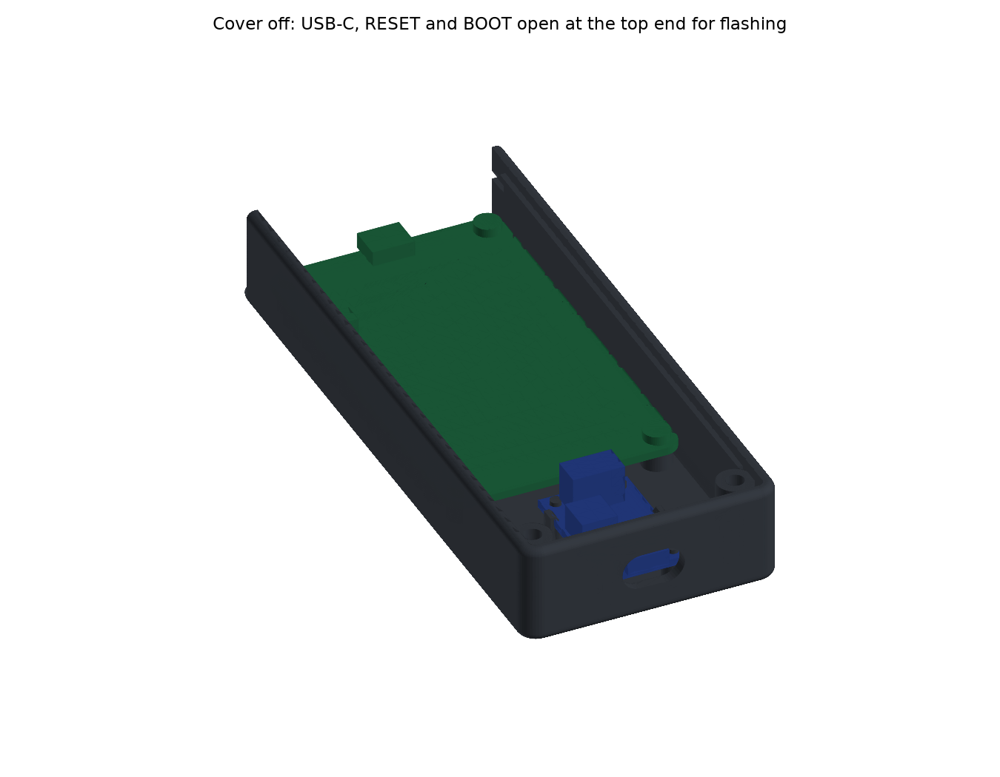

# Media room remote: handheld enclosure

A 3D-printable, TV-remote-shaped case for [`apps/media-room-dashboard`](../../README.md) running on battery: the Freenove ESP32-S3 2.8" CYD (FNK0104), an Adafruit BQ25185 charger (6092) and a 1200 mAh 504060 LiPo. It's a parametric Python model built with [build123d](https://github.com/gumyr/build123d), on the same pattern as the [espframe stand](../../../espframe/hardware/stand/README.md). One command rebuilds every print file, the preview images and a set of fit checks.

This is **variant 1**: the BQ25185 charger with no fuel gauge (build A of the remote's cable map, minus the gauge and the USB divider). Variant 2 (a MAX17048 gauge, plus either a VBUS divider on the BQ25185 or a swap to a BQ24074) isn't designed yet. See [Variants](#variants).

| | |
|---|---|
|  |  |
|  |  |
|  |  |

## How it works

Left and right are as seen from the front, with the screen upright.

- **Shape.** 55 × 132.6 × 21.5 mm. The screen sits in the top part, and a grip below it holds the charger. Plan corners are R4 and the front and back edges are rounded R1.6.
- **Front shell (PETG).** Bezel, side walls and bottom wall, with every board mounted in it. Its top end is open behind the bezel: the top end wall belongs to the back cover.
  - **Bezel.** The 1.5 mm front wall has a 43.6 × 58.05 opening: exactly the screen's visible window, 0.16–0.2 mm outside the lit pixels, with a 45° × 1 mm chamfer on the front. Its lip rests on the glass's black border (≥ 2.74 mm all round). The bezel runs on to the very top as a lip over the cover's end wall.
  - **Freenove.** It drops in face down onto four Ø6.4 bosses on its 42 × 78 hole pattern and is fixed with M3 × 6 screws from behind into M3 × 4 heat-set inserts. The boss faces stop the PCB so the glass floats 0.1 mm behind the bezel instead of being clamped. Its USB-C faces the open top end.
    - That's upside down for the board's native screen orientation, so the firmware turns the display and touch 180° (`boards/freenove-s3.yaml`, COM-445). The UI reads upright when the remote is held by the grip, charge port down.
  - **Charger.** It sits in the grip, component side towards the back. Four printed standoffs carry Ø2.2 pegs through its 2.5 mm holes, and two cantilever snap hooks catch its long edges (0.5 mm barbs, 1.9% strain on a snap).
    - It sits 7 mm behind the front face. That leaves 2.1 mm between the top of its screw-terminal block (measured 10.0 mm from the PCB underside) and the cover.
    - The block's 1.5 mm solder pins stop 4 mm short of the front wall, so they need no relief.
  - **Charge port.** The charger's own USB-C through the bottom end, in a 13.5 × 8 opening. That takes a 12.5 × 7 cable overmold with 0.5 mm all round, fatter than most cables, so any ordinary USB-C cable should seat fully.
- **Back cover (PETG).** It closes the back and the top end, and carries the cell. Taking it off is how you get at the battery and at the Freenove's USB-C for flashing.
  - **Top end wall.** The cover's end wall closes the shell's open top end. With the cover off, the Freenove's USB-C, RESET and BOOT are all exposed at the top.
  - **Fixing.** Two tongues on the end wall slide down into slots in the side walls' inner faces (5 mm long, 0.9 mm into a 2.2 mm wall), which holds the top. Two M3 × 8 countersunk screws at the bottom hold the bottom and lock the slide.
  - It rests on 45° ledges along both side walls and on the screw bosses.
- **Cell.** The measured EASYLANDER 504060 (61 × 40 × 5) is taped to the cover inside a ribbed pocket, with 1 mm clearance per side and room for 10% swelling.
  - The pocket sits against the left wall, leaving a 4 mm wire channel down the right.
  - It starts 16.5 mm up the Freenove from its antenna end, so the PCB antenna has no LiPo behind it.
  - The cell's front face is 1.5 mm behind the tallest part on the Freenove's back (the drawing's 4.7 mm max).
- **Wiring** (cable map build A):
  - **Pigtail.** The MX1.25 pigtail leaves the charger's `4.5V max` terminal along the remote, turns rearwards behind the Freenove's antenna end, runs up the right-hand channel beside the cell and plugs into the Freenove's `BAT` socket. The run is about 95 mm, so the pigtail must be at least 115 mm long.
  - **Cell lead.** The cell sits with its protection-PCB end down. Its 80 mm JST-PH lead leaves that end near the middle (19.5 mm from the edge) and drops into a bay beside the charger, with room for the plug and the lead's turn.
    - The pocket's bottom rib is only 1.5 mm tall, so the lead passes over it wherever it leaves.
    - Straight from the middle the run is 51 mm. Taped along the end to the right-hand corner first, as the user's cell has them with the label towards the board, it's 61 mm.
    - Fitted the other way round (wires taped to the left-hand corner), it would need 87 mm: peel the tape and run the lead from the middle instead.
  - The `3.3V` terminal stays unused.
- **CHG window.** A Ø2.5 hole in the cover over the charger's orange CHG LED.

## Updates and flashing

Normal firmware updates go over Wi-Fi: the remote's update check, or the admin portal's upload page (see the [dashboard README](../../README.md)). USB is only for first flashing or recovery, and **flashing over USB means taking the back cover off**:

1. Take out the two bottom screws, slide the cover 5.5 mm towards the top and lift it off. The cell comes with it, still plugged in.
2. Plug a USB-C cable straight into the Freenove's port at the open top end.
3. To force download mode, hold BOOT (left of the port, seen from the back), tap RESET (right of it), then let go of BOOT. Both buttons are open to a fingertip or a pen.

Only plug the Freenove's USB-C in for flashing (see the cable map). The remote charges through the bottom port.

## Download the print files

Every merge to `master` that changes the enclosure attaches `media-room-remote-enclosure-<version>.tar.gz` to that build's [GitHub release](https://github.com/rcompton78/compton-diy/releases). The tarball holds the 3MF/STL/STEP files, `checks.txt`, this README and the preview renders. CI only publishes it when every check passes.

## Building

```bash
pnpm nx run media-room-remote-enclosure:cad
```

This creates (or refreshes) a local Python venv (`setup.sh`, Python 3.10–3.13, pinned `requirements.txt`, the same pins as the espframe stand) and then runs `python -m remote.build`, which:
- builds both parts and writes `out/media-remote-v1-{shell,cover}.{stl,3mf,step}` in their print poses. `out/` is gitignored;
- runs the checks below, writes `out/checks.txt`, and exits non-zero if any check fails;
- renders the preview PNGs into `docs/`. These are committed so this README shows them.

`pnpm nx run media-room-remote-enclosure:release` runs `cad` and then packs the tarball into `dist/media-room-remote-enclosure/` with `scripts/pack-hardware-release.sh`. On merge to `master`, `.github/workflows/release.yml` runs it on the self-hosted runner, with the venv cached at `/hdd/compton-diy/venv-media-room-remote-enclosure`.

Every dimension is a named constant in [`remote/params.py`](remote/params.py), tagged `MEASURED`, `SOURCED` or `DESIGN`. Change a value and re-run the target.
- **Sources.**
  - Freenove FNK0104: it's LCDwiki's ES3C28P under another name. The outline drawing is on p13 of `Datasheet/ES3C28P_ES2N28P_Specification_V1.0.pdf` in [Freenove_ESP32_S3_Display](https://github.com/Freenove/Freenove_ESP32_S3_Display).
  - BQ25185: Adafruit's Eagle board file in [Adafruit-bq25185-with-3.3V-Buck-PCB](https://github.com/adafruit/Adafruit-bq25185-with-3.3V-Buck-PCB).
- **Reserved envelopes instead of measurements.** Where a part's exact size doesn't matter, the model reserves generous room round it rather than waiting on a measurement:
  - the Freenove's USB-C: anything up to 2.8 mm past the PCB and 4.5 mm tall;
  - RESET / BOOT;
  - the `BAT` socket and its plug: 12 × 12 × 6 mm;
  - the cable overmold;
  - the charger's USB-C height.

## Checks

`out/checks.txt` has the full detail.

| Check | Result |
|---|---|
| Freenove sits on its four bosses | on the 42 × 78 pattern; boss faces touch the PCB; glass floats 0.10 mm behind the bezel |
| Bosses clear the glass ends | 1.02 mm (need ≥ 0.5) |
| Shell and cover clear the Freenove's back parts | nothing inside the 4.7 mm keep-out over the whole PCB |
| Freenove screws and inserts | M3 × 6 reaches 4.4 mm into a 4.6 mm insert hole; 1.3 mm of bezel left in front |
| Bezel frames the active area | opening = visible window; 0.16 mm min reveal; nothing over the lit pixels |
| Bezel lip rests on the glass border | ≥ 2.74 mm on every side |
| Flashing port reachable with the cover off | a 12.5 × 7 overmold plugs in from the open top end, 4.1 mm clear of the bezel lip |
| End wall closes over the USB-C | the USB-C envelope is 0.2 mm clear of the cover's end wall |
| RESET / BOOT / USB-C open with the cover off | nothing of the shell behind the board's top 8 mm |
| Charge port | 13.5 × 8 opening: a 12.5 × 7 overmold seats against the mouth with 0.5 mm all round, on the connector's axis |
| Charger seats on its standoffs | 4 standoffs, pegs 0.15 mm per side in the holes, no overlap |
| Charger snap hooks | 0.5 mm barbs; 7.2 mm arms flex 0.65 mm at 1.9% strain (limit 2%) |
| Terminal block under the cover | measured 10 mm block: 2.1 mm to the cover (need ≥ 2); nothing over its screws |
| Terminal solder pins | 1.5 mm pins stop 4.0 mm short of the front wall; no relief needed |
| Cell pocket clearance / swelling | measured 61 × 40 × 5 cell: 1.0 mm per side; swollen 10% it still clears everything |
| Cell kept off the antenna end | pocket starts 16.5 mm up the PCB (keep-out 15) |
| Pigtail run | 95 mm run, so a pigtail of at least 115 mm (+6 stripped into the terminal, +10 slack); ≥ 1.2 mm from any part |
| Wire channel beside the cell | 4.0 × 6.9 mm |
| Cell lead run | 51 mm from the middle of the end, 61 mm via the right-hand corner, of the measured 80 mm lead |
| Cell lead clears the bottom rib | the 1.5 mm rib passes 0.85 mm under the lead and still catches 1.1 mm of the cell's end |
| JST-PH plug bay | plug plus 8 mm for the lead to turn, clear |
| Cover fits the shell | 0.2 mm round the edge; rests on the ledges and bosses |
| Cover slides into its tongue slots | laid in 5.5 mm high, it drops straight in and slides home without touching the shell; 1.1 mm of side wall left behind each slot |
| Cover screw engagement | M3 × 8 countersunk flush in the 2.4 mm cover, 5.6 mm into an insert |
| BAT socket and plug clear | 12 × 12 × 6 mm round the socket |
| Every part fits the P1S bed | shell 55 × 133 × 21.5, cover 55 × 130 × 20 |

## Parts to print

PETG on the stock Bambu P1S profile, 0.4 mm nozzle, 0.2 mm layers, no supports.

| File | Orientation | Settings |
|---|---|---|
| `media-remote-v1-shell` | As exported: bezel face down on the bed, walls, bosses and hooks up. The screen chamfer is a 45° overhang; the charge opening bridges 13.5 mm. | 3 walls, 20% infill. A smooth plate gives a glossy front, a textured plate a matte one. |
| `media-remote-v1-cover` | As exported: outer face down, end wall, pocket ribs and tongue webs up. Each tongue sticks out 1.1 mm sideways from its web (a short overhang). The countersinks open onto the bed. | 3 walls, 20% infill |

Heat-set inserts go in at 220–240 °C, pressed square and flush (hole Ø4.0 = `INSERT_HOLE_D`, confirmed in PETG on the espframe stand's coupons).

## Bill of materials

| Qty | Part | Notes |
|---|---|---|
| 1 | Freenove ESP32-S3 2.8" display (FNK0104) | |
| 1 | Adafruit BQ25185 USB/DC/Solar charger with 3.3V buck (6092) | Cut the rear jumper for 0.5 A charge, per the cable map |
| 1 | EASYLANDER 504060 1S LiPo, 1200 mAh | Measured 61 × 40 × 5 mm, 80 mm JST-PH lead from the protection-PCB end |
| 1 | MX1.25 2-pin pigtail, **at least 115 mm** | Socket end to bare ends; splice an extension on if it's shorter. Bare ends into the `4.5V max` terminal, red to +, black to − |
| 6 | LUKAISEN M3 × 4 × 4.2 heat-set inserts | 4 Freenove bosses, 2 cover bosses |
| 4 | M3 × 6 pan head | Freenove to its bosses, from behind |
| 2 | M3 × 8 countersunk (ISO 10642 / DIN 7991) | Cover. Pan heads would stand ~2 mm proud. |
| 1 | Thin double-sided tape, ≈ 40 × 60 mm, ≤ 0.4 mm | Cell to the cover |

## Assembly

1. **Inserts.** Press the four M3 × 4 inserts into the Freenove bosses (inside the shell, round the screen opening) and two into the cover bosses at the bottom corners.
2. **Wire the charger.** Cut the charger's rear jumper. Strip and tin the pigtail's bare ends and clamp them in the `4.5V max` terminal, red to `+` and black to `−`, checking the silkscreen. Check polarity at the MX1.25 plug before it goes near the Freenove (see the cable map).
   - Tip: the terminal block's solder pins stick out 1.5 mm under the charger. The case already clears them, but you can trim them flush with side cutters if you like.
3. **Charger.** Lay the shell face down. Line the charger's USB-C up with the bottom opening, component side up, and press it straight down over the four pegs until both hooks click over its edges. The pigtail points up the remote.
4. **Freenove.** Lower the board face down onto the four bosses, USB-C to the open top end, and fix it with four M3 × 6 screws. Don't overtighten: the glass must stay free behind the bezel.
5. **Pigtail.** Run it along the remote from the terminal, behind the Freenove's bottom (antenna) end, then up the channel on the `BAT` socket's side (the remote's right, so on your left as you look into the open back) and onto the socket.
6. **Cell.** Lay the cover on the bench ribs up, end wall away from you. Put tape on the **unlabelled** face of the cell and press it into the pocket **label side up** (towards the board once closed), protection-PCB end towards you (the screw end).
   - The lead leaves the end nearest you, over the low bottom rib.
   - If the wires are taped along the end, that's to the right-hand corner. If they turn out to be taped to the left-hand one, peel the tape and run the lead straight from the middle.
   - Plug it into the charger's JST-PH socket: the plug sits in the bay on the charger's right (on your left looking into the back).
7. **Cover.** Lay the cover into the back 5.5 mm short of the top end, so its two tongues are just above the side walls' ends. Slide it towards the top until the end wall meets the walls and the screw holes line up, then fit two M3 × 8 countersunk screws.
8. **Check.** Plug a charger into the bottom port: the orange CHG LED shows through the window in the cover. Unplug it and the remote runs from the cell.

**Battery service:** two screws out, slide the cover up and lift it off with the cell on it, then unplug the JST-PH.

## Variants

`remote/params.py` keeps the boards a variant carries in `VARIANTS`. Each entry names its `Charger` (a dataclass of board size, holes, connector footprints, terminal pins and LED position) and, later, any extra boards. `python -m remote.build --variant N` builds variant N, with output names prefixed `media-remote-vN-`. The parts read everything charger-specific through `geom.ChargerFrame`, so a new charger is a new `Charger` entry and a new `Variant` row.

Only variant 1 exists. Variant 2's gauge (and divider, or a BQ24074) will need a mount and the wiring room added when it's decided.

## Future options

- **Panel-mount charge socket.** The charge port could become a panel-mount USB-C socket, wired to the charger's `VU`/`G` pads instead of using the board's own USB-C. It has to be one that works with C-to-C cables, i.e. with 5.1k CC pull-down resistors built in. That would free the charger's position from the bottom wall and give a cleaner, flush port. Not designed yet.

## Open items

- **Test print: done.** Both parts were printed in PETG and test-fitted: everything fitted first time, with no changes needed. If a different printer or filament comes out tight or loose, tune:
  - `HOOK_BARB` and `CHARGER_EDGE_CLEAR` for the charger's snap hooks;
  - `TOP_TONGUE_IN` and `TOP_SLOT_CLEAR` for the cover's tongues;
  - `INSERT_HOLE_D` for the heat-set inserts.
- **Pigtail:** not bought yet. Buy one of at least 115 mm, or splice. The build prints the current minimum in the pigtail check.

Design history: Linear COM-445.
